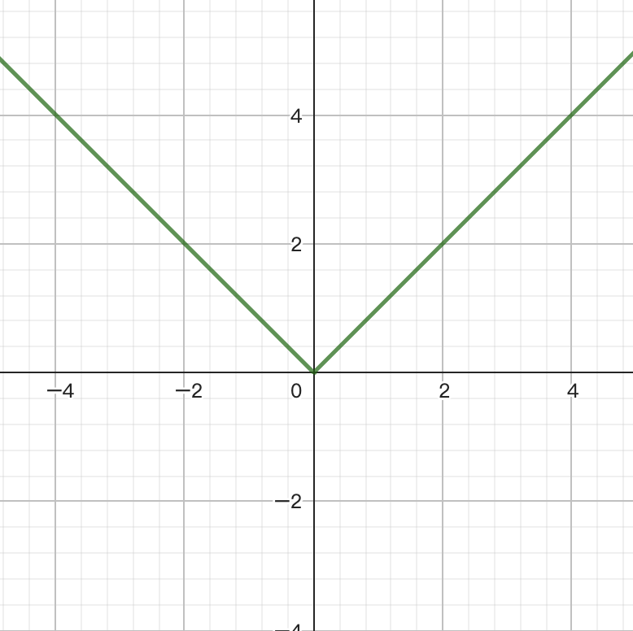

# 1 - 椭圆曲线密码学

椭圆曲线密码学（Elliptic Curve Cryptography，ECC）

椭圆曲线密码学和区块链之间的关系非常紧密，是区块链世界里最核心的加密技术之一。

# 函数

## 方程（Equation）

方程由一个等式构成，其中包含至少一个未知数或变量，通过等号（=）将两个表达式连接在一起。

一个方程通常有两个部分，左边和右边，它们通过等号（=）连接：

$$
左边=右边
$$

- 左边和右边通常是代数表达式，可能包含常数、变量、运算符（如加法、乘法等）。
- 变量是未知的数值，我们通过求解方程来确定它的值。
- 常数是已知的数值。

## 显式方程

变量之间关系以一种直接、明确的方式表达的方程，通常是一个变量被孤立地表示为其他变量的函数，通常写作 $y=f(x)$ 或 $z=f(x,y)$ 的形式，即一个因变量完全由自变量的表达式来确定。例如，

$$
y=x^2-4
$$

## 隐式方程

变量之间关系通过一个包含所有变量的表达式等于零（或一个常数）的形式来表达的方程，通常写作 $F(x,y)=0$ 或 $F(x,y,z)=C$（其中 C 是常数）的形式，即因变量和自变量通常混合在一起，没有被明确地分离出来。例如，

$$
x^2+y^2=1
$$

注：即便将上式重写为 $y^2=1-x^2$ 也并没有改变它的隐式性质，因为它仍然没有将 y 唯一地表示出来。

## 显函数

通过显式方程表达的函数。形式：

$$
y=f(x) 或 z=f(x_1,x_2,...,x_n)
$$

对于每一个输入值 x，有且仅有唯一一个输出值 y 与之对应。x, y 是一个一对一或多对一的映射。

## 隐函数

由一个隐式方程间接定义的函数。形式：

$$
F(x,y)=0 或 F(x,y,z)=0
$$

方程描述了 x 和 y 之间的一种关系。当所有满足这个关系的 (x,y) 点在坐标系上绘制出来时，它们形成了一条曲线。在许多情况下（比如圆、椭圆曲线），对于一个给定的 x 值，可能对应多个 y 值。所以，严格意义上讲，一个由隐式方程定义的隐函数所代表的整个图形，往往并不能满足函数“一对一”或“多对一”的映射关系。那为什么隐函数被称为函数呢？

**历史沿袭**：在微积分发展过程中，这种形式的方程被用于研究变量之间的依赖关系，即使这种依赖关系并非严格的函数。

**局部函数性**：虽然整个曲线可能不是一个函数，但根据隐函数定理（Implicit Function Theorem），在曲线上非奇异点的附近，如果 $∂F/∂y \neq 0$，那么我们可以把 y 局部地看作是 x 的一个函数。这意味着，我们可以将曲线的某一部分“剥离”出来，而这部分恰好是一个显式函数。

### 隐函数定理

隐函数定理回答了这么一个问题：

对于一个由隐式方程  **$F(x,y)=0 或更一般的 F(x_1,…,x_n,y_1,…,y_m)=0$**  所定义的曲线或曲面，我们是否能在局部区域内将其表示为一个显式函数？如果能，那么这个显式函数的性质又如何？

隐函数定理给出了一个条件，在这个条件下，我们保证在隐式方程定义的曲线（或曲面）的某个点附近，可以找到一个局部区域，使得在这个区域内，一部分变量确实可以被看作是另一部分变量的函数。而且，这个局部函数是连续可微的。

> 考虑一个由方程 $F(x,y)=0$ 定义的曲线。假设在曲线上有一个点 $(x_0,y_0)$ 使得 $F(x_0,y_0)=0$。如果满足以下两个条件，那么在点 $(x_0,y_0)$ 的一个邻域内，存在一个唯一的显式函数 $y=f(x)$，使得 $F(x,f(x))=0$ 成立，并且这个函数 $f(x)$ 是连续可微的。
> 
> 1. **$F(x,y)$ 在点 $(x_0,y_0)$ 的某个邻域内连续可微。** （这是为了保证函数足够“光滑”，可以求导）
> 2. **$F$ 关于 $y$ 的偏导数 $∂F/∂y$ 在点 $(x_0,y_0)$ 处不等于零，即 $\frac{∂F}{∂y}(x_0,y_0)\neq0$。**

在满足以上两个条件时，隐函数的求导公式为：

$$
\frac{dy}{dx}=-\frac{\partial F/\partial x}{\partial F/\partial y}
$$

## 奇异点

指的是曲线上所有那些“不平滑”或“不规则”的点。

### 尖点

在尖点处，函数**不可导**，导致**切线是未定义或不存在的**。例如，

$$
y=∣x∣
$$

其在点  $(0,0)$  处的切线不存在。

### 自相交点

曲线在该点与自身相交，形成一个交叉点。在自相交点处，曲线有**多条定义明确的切线。例如，**

$$
y^2=x^3+x^2
$$

其在点  $(0,0)$  处有两条切线。

### 奇异性判断

对于显式函数，判断一个点是否奇异，是直接通过检查其导数是否存在（例如左右导数是否相等）来完成的。

对于由隐式方程 $F(x,y)=0$ 定义的曲线，点 $(x_0,y_0)$ 是奇异点当且仅当它满足以下三个条件：

1. 点 $(x_0,y_0)$ 在曲线上，即满足原始方程 $F(x_0,y_0)=0$。
2. $\frac{∂F}{∂x}(x_0,y_0)=0$
3. $\frac{∂F}{∂y}(x_0,y_0)=0$

# 椭圆曲线基础

椭圆曲线是满足特定方程的点集。

比如最常见的 **Weierstrass 曲线**，其短方程为：

$$
y^2=x^3+ax+b
$$

其中 a, b 是常数，它们的值决定了曲线的具体形状。

# 非奇异性

为了让椭圆曲线能够用于密码学应用，它必须满足一个条件：**非奇异性**。换句话说，椭圆曲线必须是 **非奇异的**（non-singular）。

非奇异性保证了椭圆曲线的稳定性和良好的代数结构，使得我们能够在其上定义加法运算，并且该运算满足一些重要的代数性质，比如：

- **闭合性**：曲线上的两个点相加，结果仍然在曲线上的某个点。
- **交换律**：曲线上的点加法满足交换律。
- **结合律**：曲线上的点加法满足结合律。

这些性质使得 ECC 成为一个非常适合用来实现公钥加密、数字签名和密钥交换的数学结构。

判断其是否非奇异，可以通过计算其判别式（Discriminant）来完成。对于上述Weierstrass方程，判别式 $\Delta$ 定义为：

$$
\Delta=−16(4a^3+27b^2)
$$

- 如果 $\Delta \neq 0$，则该椭圆曲线是非奇异的（光滑的）。
- 如果 $\Delta=0$，则该椭圆曲线是奇异的，即存在至少一个奇异点。

# 椭圆曲线离散对数问题

椭圆曲线离散对数问题（Elliptic Curve Discrete Logarithm Problem, ECDLP）是椭圆曲线密码学（ECC）安全性的核心基石。简单来说，是指给定椭圆曲线上的一个点 P 和另一个点 $Q=kP$（k 是某个整数），在计算上很难从已知的点 P 和 Q 推算出整数 k 的值。

对于**奇异椭圆曲线**，由于其代数结构的不规则性和不稳定性，离散对数问题的计算难度大大降低，无法为密码学提供所需的安全性。因此，只有 **非奇异椭圆曲线** 才具有良好的 **ECDLP** 难度，也因此被广泛用于椭圆曲线密码学（ECC）中的各种加密协议和算法。

想象一下，你有一张特殊的地图（椭圆曲线），上面有无数个独特的地点（曲线上的点）。地图上有一种特殊的导航规则（椭圆曲线点加法），如果你在一个地点，想去另一个地点，你必须严格按照这个规则移动。在这个地图上，有三个关键元素：

1. 基点 P (公共起点)：这是一个在地图上公开且预先约定好的起始地点。所有使用这张地图的人都从这里出发。它不是任何人的秘密，而是整个导航系统的基础。

    💡
    
    在数学上，**P** 是椭圆曲线上一个经过精心选择的固定点。

2. 私钥 k (秘密路线)：这是你秘密拥有的、一个非常大的整数，它代表着你的“秘密导航路线”，也就是你要从起点 P 出发，沿着导航规则走多少步。这个 k 是绝对保密的。

    💡
    
    在数学上，**k** 是一个随机选取的大整数。

3. 公钥 Q (公开目的地)：这是你从起点 P 出发，按照你的秘密路线 k 步一步地走，最终到达的最终目的地。你可以把这个目的地公开告诉任何人。

    💡
    
    在数学上，**Q** 是通过将基点 **P** 与标量 k 进行椭圆曲线点乘运算得到的结果：$Q=kP=P+P+⋯+P$（k 次相加）。

ECDLP 的核心就是，

- 正向计算（容易）： 已知 P 和你的秘密路线 k，要找到目的地 Q，是相对容易的。 你只要按照规则一步步走就行了，无论 k 有多大，计算起来都很快。
- 逆向求解（极其困难）： 已知起点 P 和目的地 Q，要反向推导出你走了多少步（你的秘密路线 k），是极其困难的。 尽管你知道起点和终点，但由于地图的单向性（无法反向移动）和复杂性（规则复杂且地点众多），几乎不可能在合理的时间内找到这条秘密路线 k。

ECDLP 的这种“单向性”（正向容易，逆向困难）是构建现代加密系统的理想特性。

# 常见的椭圆曲线

## 比特币

比特币使用的椭圆曲线是 **secp256k1**，是一个 Weierstrass 型曲线，其曲线方程为

$$
y^2=x^3+7
$$

在比特币中，基点是椭圆曲线上的一个特定点，其坐标是：

$$
G=(x_G,y_G)=(0x79BE667EF9DCBBAC55A62B56F9C0C6D2F5ACD9E6B86D36A7B56F5B4D39B2C6E8,0x483ADA7726A3C4655DA4FBFCF06D4D4F0D91E74A5A2E60E7E5F8C37FF4E4C4F9)
$$

## 以太坊

以太坊使用的椭圆曲线是 **secp256r1**，是一个 Weierstrass 型曲线，其曲线方程为

$$
y^2=x^3+ax+b
$$

其中 $a=−3, b=41058363725356735756780557623000$

在以太坊中，基点是椭圆曲线上的一个特定点，其坐标是：

$$
G=(x_G,y_G)=(0x6B17D1F2E12C4247F8B85A2DBDCEAF8F8B2A8CDE4A4F1E876DA6AA42A2B11A02,0x4FE342E2FE1A7F9B8C9A935C8C43F3E9A0B2BB219F1A0D2FFBC87A5E26DBF1D3)
$$

## Solana

与比特币和以太坊使用的 **secp256k1** 和 **secp256r1** 不同，Solana 的选择是 **Ed25519。Ed25519** 是由 **Daniel J. Bernstein** 在 2008 年设计的一种高安全性、快速的椭圆曲线，属于 **Montgomery 曲线** 家族，这与传统的 **Weierstrass 曲线** 有所不同。

Montgomery 曲线的方程一般是：

$$
y^2=x^3+Ax^2+x
$$

具体到 **Ed25519**，它的曲线方程为：

$$
y^2=x^3+486662x^2+x
$$

其基点 G 的坐标 $(x_G, y_G)$ 是：

$$
G=(x_G,y_G)=(0x216936D3CD6D0C5D7E9AC25A701A23A6CC9F053B282ED88EAFBDE9159C27E7F5,0x666666666666666666666666666666666666666666666666666666666666666)
$$

---

[返回课程首页](../../README.md)
