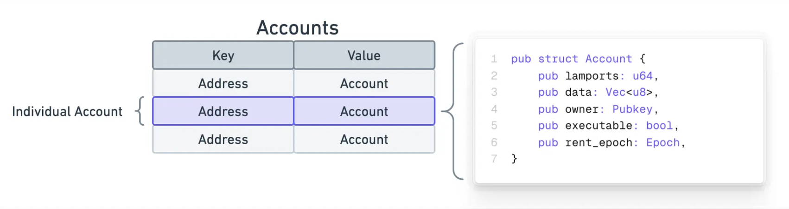

# 2 - Account

在 Solana 中，一切都是账户 (Account)。Solana 的账户是存储数据的地方。

可以这么理解，Solana 上的所有数据都存储在一个名为 **“Accounts”** 的单一表格（table）中。在这个表格中，每一行都代表着一个 **“账户”**。



注意，每个账户最多可以存储 **10MB** 的数据。

## 账户地址

每个账户都有一个**唯一的地址**。这个地址是一个32字节的二进制数据，即 $32×8=256$ 位。直接显示和使用 32 字节的二进制数据是非常不方便的（例如 `0x2a3b...` 这样的十六进制表示或者更难读的二进制）。因此，Solana 选择使用 **Base58 编码**来表示这些地址。

Base58 是一种文本编码格式，它使用 58 个不同的字符来表示二进制数据。Base58字符集：

$$
123456789ABCDEFGHJKLMNPQRSTUVWXYZabcdefghijkmnopqrstuvwxyz
$$

Base58 与 Base64 很相似，但 Base58 去除了某些字符（如0、O、I、l），以避免视觉混淆。假设我们有一个32字节的Solana账户地址，比如通过 Ed25519 生成的一个 公钥（256位的二进制数据），

$$
0x14 0x4a 0x56 0x39 0x9d 0x5b 0x4c 0x11 0x8f 0x62 0x59 0x23 0x48 0x59 0x57 0x69 0xa1 0xf1 0x2c 0x94 0xda 0x3b 0x67 0x94 0x8a 0xc5 0x0f 0x47 0x8b 0x92 0x55 0x7f 0xe7
$$

通过Base58编码，它会被转换为一个短小且可打印的字符串（例如），

$$
14grJpemFaf88c8tiVb77W7TYg2W3ir6pfkKz3YjhhZ5
$$

Base58 编码本身是一种变长编码，编码后的字符串长度仍可能略有不同。例如，你可能会看到 Solana 地址的长度在 32 到 44 个字符左右浮动。

大多数账户的地址是基于 **Ed25519** 加密算法生成的，该算法生成的公钥长度为256位，被直接作为账户地址使用。Solana还支持一种特殊类型的地址，叫做**程序派生地址**（Program Derived Addresses），该地址由一个 **程序ID** 和 **种子**（Seeds）生成的。PDA的生成是确定性的，意味着给定相同的程序ID和种子，任何人都能生成相同的PDA地址。

1. 输入数据

PDA的生成需要两个关键的输入：

- 程序ID：智能合约被编译后部署到链上，会被存储到一个特定的账户里，该账户的地址就是程序ID。把程序 ID 理解为你的应用程序在 Solana 链上的身份证号码或者门牌号。
- 种子（Seeds）：这些可以是任何用户定义的数据。种子可以用于进一步区分由同一个程序生成的多个不同PDA。也就是说通过改变种子，同一个程序可以派生出无数个不同的 PDA。种子必须是字节数组（byte array），一个由 **字节** 组成的数组。
1. 生成过程

PDA的生成过程涉及以下几个关键步骤：

2.1 拼接输入

首先，程序ID和种子数据会被拼接成一个字节序列。这个过程是将所有输入的值转换成字节形式并按顺序组合起来。种子可以是任意字节数组，程序ID是一个Solana账户公钥。

- 程序ID是一个32字节的公钥。
- 种子可以是任意长度的数据（例如，字符串、数字或其他字节序列）。

2.2 计算哈希

将拼接后的字节数据输入到一个哈希函数中（Solana使用的通常是**SHA-256**或类似的加密哈希算法），生成一个256位（32字节）的哈希值。这个哈希值是PDA的初步候选地址。

2.3 生成最终地址

Solana的系统会检查生成的哈希值，确保它符合Solana地址的规则。否则系统会自动调整或重新计算，直到生成有效地址。注意，一个有效的 PDA 地址不能是一个有效的 Ed25519 公钥。除了 PDA的其他 Solana 地址都必须是 **有效的 Ed25519 公钥，**这意味着它们在 Ed25519 椭圆曲线上必须有对应的点，而 PDA 地址必须脱离曲线（Off-Curve）。

PDA的生成由一个称为 **findProgramAddress** 的函数处理。该函数接受 种子 和 程序ID 作为输入，并尝试查找一个PDA。

- 它从一个初始的 bump_seed 值（255）开始。
- 它将种子、程序ID和当前的 bump_seed 连接起来。
- 然后，它将这个连接的字节数组通过加密哈希函数（Solana使用的是SHA-256）进行处理。
- 该哈希函数的输出被视为潜在的公钥。
- 它接着检查这个潜在的公钥是否位于Ed25519椭圆曲线上。
- 如果该潜在的公钥是一个位于曲线上的地址，函数会减少 bump_seed 的值（从255到254，再到253，依此类推），并从第2步开始重复这个过程。该函数会不断循环，直到找到一个 bump_seed 值，使得生成的地址不再位于椭圆曲线上，这个最终的地址就是PDA。函数最后同时返回 PDA 和这个 bump_seed。
    
    ```tsx
    import { PublicKey } from '@solana/web3.js';
    
    // The program ID of your Solana program
    const programId = new PublicKey('...');
    
    // The seeds you want to use for this PDA
    const seeds = [Buffer.from('unique_seed'), Buffer.from('another_seed')];
    
    // Generate the PDA and the bump seed
    const [pda, bump] = PublicKey.findProgramAddressSync(seeds, programId);
    
    console.log('PDA:', pda.toBase58());
    console.log('Bump Seed:', bump);
    ```
    

## 账户的数据结构

所有 Solana 的账户都遵循相同的数据结构。

```rust
pub struct Account {
    /// lamports in the account
    pub lamports: u64,
    /// data held in this account
    #[cfg_attr(feature = "serde", serde(with = "serde_bytes"))]
    pub data: Vec<u8>,
    /// the program that owns this account. If executable, the program that loads this account.
    pub owner: Pubkey,
    /// this account's data contains a loaded program (and is now read-only)
    pub executable: bool,
    /// the epoch at which this account will next owe rent
    pub rent_epoch: Epoch,
}
```

1. lamports 字段用于记录账户的 **余额**，它用于表示一个账户持有的 SOL 数量。

$$
1 SOL = 10^9 lamports
$$

1. data 字段存储了与账户相关的 **任意附加数据**。这个字段是一个字节数组，可以包含任何类型的数据。通常被称为“账户数据”。对于程序账户（智能合约），这个字段包含的是 **可执行程序代码本身** 或 **存储可执行程序代码的另一个账户地址**。对于非可执行账户，这个字段通常存储的是 **用于读取的状态**。

1. owner 字段是拥有该账户的程序的Program ID，这是一个 32 字节的公钥。每个 Solana 账户都有一个指定的程序作为其拥有者。只有拥有该账户的程序才能更改账户的数据或扣减其 lamports 余额。

1. executable 字段表示该账户是否为 **可执行账户**。如果 executable 为 true，那么该账户就 **是一个程序账户（智能合约）**，能够接收并执行指令。如果 executable 为 false，该账户是一个普通账户，不可执行任何指令。

1. rent_epoch 字段表示账户下一个需要 **支付租金的时期（epoch）**。现已不再使用，这个租金收取机制已经被弃用。

## 账户的分类

### 1. Sysvar Accounts

**系统变量账户** 是一类非常特殊的**只读账户**，它们存储了 Solana 区块链的**实时状态和网络信息**。你可以把它们想象成区块链的“全局变量”或“环境参数”，智能合约（程序）可以读取这些账户的数据来获取当前的链上上下文信息。

每个 Sysvar 都有一个预定义的、**固定且众所周知的账户地址**。这意味着你的程序可以很容易地引用它们，而不需要在交易中作为常规账户传递。

### 2. System Accounts

**系统账户** 是 Solana 网络中最基础的账户类型，这些账户主要用于存储数字资产，并且能够参与交易、支付交易费用等操作。在 Solana 中，系统账户是由 **System Program** 管理的，通常指通过 System Program 创建的账户。系统账户可以是 **钱包账户**（例如持有代币的账户），也可以是用于其他目的的账户如程序管理的账户（System Program 还能帮你创建一些账户，后续再交给其他程序来使用，通过 `assign` 指令，把它的 `owner` 改成某个自定义程序，让那个程序接管）。

💡 只要账户的 `owner` 是 `System Program`，它就是系统账户。这类账户只受 System Program 约束，不受其他程序逻辑控制。

对于钱包账户而言：

- lamports 这是你钱包里实际拥有的 SOL 余额。
- data 字段是空的，钱包账户的主要作用是持有 lamports，而不是存储自定义数据。
- System Accounts 的 owner 是 System Program，即，这些账户的 owner 字段被设置为 Solana 系统程序的地址。


- executable 字段总是 false。

### 3. Program Accounts

**程序账户** 是一种非常特殊的账户，它存储着你的**智能合约代码**。你可以把它想象成在 Solana 区块链上可执行的应用程序本身。

程序账户的作用就是存储编译后的智能合约（用 Rust 或其他语言编写的，然后编译成 BPF 字节码）。当你部署一个智能合约到 Solana 链上时，实际上就是将合约代码写入到一个新的程序账户中。

程序账户的地址就是我们所说的**程序 ID (Program ID)**。这是一个唯一的 32 字节公钥，用来标识和引用你的智能合约。所有其他账户如果想与你的合约交互，都需要知道这个程序 ID。

- 程序账户的 lamports ****字段存储的是该程序账户所拥有的 SOL 数量，就是这个程序账户的 **SOL 余额，**这个余额主要用于支付该程序账户在链上存储的**租金 (rent)**。
- 程序账户的 data 字段只存储程序代码。程序运行时不会直接修改自身的 data 字段（除非是程序升级，那也是通过特定的加载器指令完成的）。程序的**状态**（比如用户的余额、NFT 列表等）会存储在**单独的数据账户**中，这些数据账户通常由该程序自己拥有。
- 程序账户由一个特殊的**加载器程序**拥有，目前 Solana 主要使用的是 BPFUpgradeableLoader (BPFUpgradeableLoader1111111111111111111111111111111).
- 程序账户的 executable 字段被设置为 true，表示这个账户包含可执行的指令。当一个交易调用这个账户时，Solana 运行时就会执行其中存储的代码。


下面是一些 **特殊的程序账户**。

**(1) System Program**

在 Solana 区块链上，系统程序 (System Program) 是一个最基础、最核心的智能合约。它不是由第三方开发者部署的，而是 Solana 运行时本身内置的，拥有特殊的权限和功能。你可以把它想象成 Solana 操作系统最底层的“内核”或“骨架”，负责管理最基本的区块链操作。

系统程序有一个众所周知的、固定的账户地址（程序 ID）：

$$
11111111111111111111111111111111
$$

由 32 个 1 组成。

System Program 的 owner **字段** 为空，也就是说 **没有其他程序控制它**。

💡

**System Program** 和 **System Account** 是两个不同的概念。**System Program** 是 Solana 区块链上一个**原生程序**。**System Account** 是指**所有者**为 **System Program** 的账户。当你创建一个新的 Solana 钱包时，你所得到的账户就是一个 System Account。

**(2) Loader Program**

加载器程序 是 Solana 网络中的一类特殊程序，它们负责管理和部署 Solana 上的由用户开发的智能合约。Solana 中的每个程序都由一个“加载器程序”拥有，而 加载器程序 的作用是 部署、升级、关闭、授权 等与智能合约相关的管理操作。

目前 Solana 中有五个主要的加载器程序版本：

| Loader 版本 | Program ID | 说明 |
| --- | --- | --- |
| **native** | `NativeLoader1111111111111111111111111111111` | 这个加载器拥有其他四个加载器。 |
| **v1** | `BPFLoader1111111111111111111111111111111111` | 管理指令已禁用，但程序仍然可以执行。 |
| **v2** | `BPFLoader2111111111111111111111111111111111` | 管理指令已禁用，但程序仍然可以执行。 |
| **v3** | `BPFLoaderUpgradeab1e11111111111111111111111` | 正在逐步淘汰。 |
| **v4** | `LoaderV411111111111111111111111111111111111` | v4 预计将成为标准加载器。 |

**(3) Buffer Accounts**

**缓冲区账户** 是智能合约（程序）代码在被最终激活之前的一个临时存储区域，在 **Solana 程序的部署和升级过程**中发挥作用。

当你开发完一个 Solana 智能合约（用 Rust 等语言编写，并编译成 BPF 字节码）并准备部署它时，你通常不会直接将代码部署到最终的程序账户中。第一步是将这段编译后的程序代码上传到一个 Buffer Account。这个过程类似于将一个文件上传到一个暂存区。

一旦代码被上传到 Buffer Account，它就存储在那里。此时，该代码还不是一个活跃的、可执行的智能合约。它只是一个**已上传但未激活**的字节码文件。

只有当你执行了最终的 deploy（首次部署）或 upgrade（升级现有程序）操作时，加载器程序才会：

- 从 Buffer Account 中读取已上传的代码。
- 将这段代码写入到**目标程序账户**（也就是你的智能合约的最终可执行账户）。
- 将目标程序账户的 executable 字段设置为 true。
- **销毁或标记** Buffer Account 为已使用。

在 loader-v3 版本中，Buffer Account 是一种**特殊的账户类型**，专门用于在部署或升级程序时临时暂存（staging）程序代码。在 loader-v4 版本中，虽然仍然存在“缓冲区”的概念（即仍然需要一个临时账户来暂存上传的代码），但这些缓冲区账户**不再是特殊类型**。它们现在被处理成**普通的程序账户 ( program accounts)**。

**(4) Program Data Accounts**

在 loader-v3 中，**程序账户 (Program Account)** 的 data 字段**不直接存储实际的可执行代码（BPF 字节码）**。相反，它的 data 字段只包含一个 32 字节的 Pubkey，这个 Pubkey 指向另一个单独的账户，即 **程序数据账户 (Program Data Account)**。程序数据账户才是真正存储智能合约可执行代码 (BPF 字节码)的地方。


### 4. Data Accounts

**数据账户** 是最常见、最核心的账户类型之一。它们是区块链上用于**存储所有应用程序数据**的地方。你可以把它们想象成你的智能合约用来读写信息的“数据库记录”或“文件”。

- lamports:  ****存储 SOL 余额，主要用于支付其在链上存储的**租金 (rent)**。如果余额不足，账户可能会被清除。如果足够支付 2 年租金，账户则成为免租账户。
- data: 数据账户的主要作用就是存储任何与应用程序逻辑相关的数据。
- owner：每个数据账户都有一个明确的**所有者程序 ID**。这是关键！只有这个所有者程序才拥有对该数据账户**写入**的权限。其他程序可以读取账户数据，但如果它们尝试修改不属于自己的数据账户，交易就会失败。
- executable：这是数据账户与程序账户最主要的区别。数据账户的 executable 字段被设置为 false，表示它们不包含任何可执行的代码。它们只是纯粹的数据容器。

Solana 采用“代码与数据分离”的设计哲学，而不是像以太坊那样将代码和状态（数据）都打包在一个合约地址中。


## 各种账户的地址类型

根据账户所使用的地址类型，账户可以分为两种：**外部账户**和**程序派生账户**。

外部账户：使用 Ed25519 公钥作为其账户地址的账户。也称钱包账户。

程序派生账户：使用 PDA (Program Derived Address) 作为其账户地址的账户。

| 账户类型 | 地址类型 | 解释 |
| --- | --- | --- |
| **System Account** | **Ed25519 公钥** | 必须有私钥用于签名，例如钱包账户。 |
| **Program Account** | **Ed25519 公钥** | 必须有私钥用于部署和升级授权。 |
| **Data Account** | **Ed25519 公钥或 PDA** | 取决于是否需要用户直接控制或由程序作为保管库。 |
| **Sysvar Account** | **PDA** | 地址由运行时确定性地派生，用于提供只读的链上全局信息。 |

## 账户创建

`System Program` 负责所有账户的**创建。**

使用 `system_program::create_account` 指令来创建新账户时，你必须提供一个 `space` 参数。这个参数指定了账户数据区域（即 `data` 字段）的大小（以字节为单位）。Solana 运行时会根据这个大小来分配所需的存储空间，并计算出账户所需的**租金**（rent）。账户一旦创建，它的存储空间就不能被扩大或缩小。这是 Solana 的一个核心设计原则，它简化了运行时（runtime）和存储管理。

如果你需要存储可变大小的数据（例如动态长度的 `String` 或 `Vec`），你必须在账户创建时为其分配**足够大的固定空间**。例如，在 `Poll` 结构体中，使用了 `#[max_len(128)]` ，它会预先分配一个固定大小的数组，对于 `String`，它会分配 `4 + 128` 个字节，其中 4 个字节用于存储实际的长度，即使你只存储了一个很短的字符串，它也占用了全部预分配的空间。

---

[返回课程首页](../../README.md)
