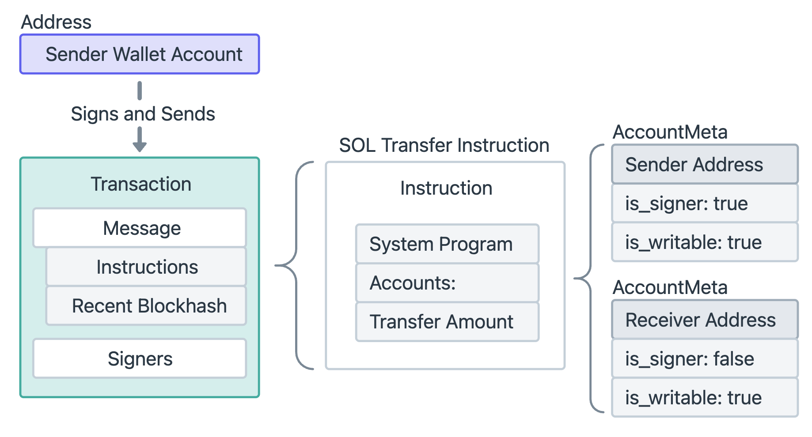

# 3 - Transaction

在 Solana 中，交易（Transaction）是用户与网络交互的方式。用户通过发送交易，要求网络执行一个或多个 指令（Instructions），这些指令定义了交易中要执行的操作。每个指令的执行逻辑是由 已部署的程序（Program）提供的，而这些程序定义了自己的一组指令。

一笔交易本质上是对 网络执行一组指令的请求。

- 如果一笔交易包含多个指令，那么这些指令会按添加到交易中的顺序依次执行。
- Solana 中的交易是原子性的，即所有指令必须成功执行，否则整个交易会失败，任何操作都不会生效。

# SOL 转账示例

钱包账户是由 System Program 所拥有的账户。在 **Solana** 中，所谓的 **"钱包"** 就是一种 **System Account**（系统账户）。这些账户用来存储 **SOL** 或其他代币的余额，并且用来进行交易支付等。**钱包账户** 是 **System Program** 所拥有的账户，也就是说，钱包的管理权限归 **System Program** 所有，转账 SOL 或修改钱包余额时，必须通过发送交易来调用 **System Program** 执行操作。



**Sender Wallet Account**（发送者钱包账户）是整个操作的发起方。发送者账户通过其私钥，构建并签名一个交易。交易的核心结构如下：

- Message (消息): 交易的主体部分。
    - Instructions (指令)：SOL 转账指令（SOL Transfer Instruction），其组成部分如下，
        - **System Program**：该指令指定的程序，负责执行 SOL 转账操作。
        - **Accounts**：列出在转账中涉及的账户，即发送者账户和接收者账户。
            - 发送者账户
                - Sender Address（发送者地址）：
                - is_signer: true：表示发送者账户需要 签署 交易。
                - is_writable: true：表示发送者账户的 余额会被修改，即从发送者账户中扣除转账金额。
            - 接收者账户
                - Receiver Address（接收者地址）：
                - is_signer: false：接收者账户不需要签署交易，因为接收者账户只是接收 SOL，并不涉及授权操作。
                - is_writable: true：表示接收者账户的 余额会被修改，即接收者账户会增加 SOL（Lamports）。
        - **Transfer Amount**：指定需要转账的 **SOL（Lamports）** 数量。
    - Recent Blockhash (最近区块哈希): 用于防止重放攻击等。
- Signers (签名者): 参与交易签名的所有账户。在本例中，发送者账户是唯一的签名者。

一旦发送者签署了交易，交易被 **发送到 Solana 网络** 由 **System Program** 进行处理：

- **从发送者账户扣除 SOL**：**System Program** 会验证发送者账户是否有足够的 **Lamports**，并在确认后从发送者账户中扣除相应的 SOL。
- **将 SOL 转账到接收者账户**：然后，**System Program** 会向接收者账户转账 SOL，增加接收者账户中的 SOL 余额。

# Instructions

每个指令都由以下 三个部分 组成：

- 程序账户地址（Program Account）：每个指令都必须指定一个程序账户地址，它代表着哪个程序来执行该指令的逻辑。
- 数据账户或钱包账户列表（Data Account / System Account）：这些账户是指令执行时需要读取或写入的账户。
- 额外数据（Extra Data）：指令所需的任何其他信息，通常是 函数参数 或操作所需的 数据。

```rust
pub struct Instruction {
    /// Pubkey of the program that executes this instruction.
    pub program_id: Pubkey,
    /// Metadata describing accounts that should be passed to the program.
    pub accounts: Vec<AccountMeta>,
    /// Opaque data passed to the program for its own interpretation.
    pub data: Vec<u8>,
}
```

在创建一个指令时，必须为每个所需的账户提供一个 **AccountMeta**。其指定了以下内容，

- **pubkey**：账户的地址
- **is_signer**：该账户是否必须签署交易
- **is_writable**：该指令是否修改账户的数据

```rust
pub struct AccountMeta {
    /// An account's public key.
    pub pubkey: Pubkey,
    /// True if an `Instruction` requires a `Transaction` signature matching `pubkey`.
    pub is_signer: bool,
    /// True if the account data or metadata may be mutated during program execution.
    pub is_writable: bool,
}
```

# Transactions

交易由以下部分组成：

- **签名（Signatures）**：一个签名数组，包含了所有需要签署的账户的签名。签名是通过使用账户的私钥对交易消息（Message）进行签名生成的。比如在 **转账操作** 中，**发送账户** 需要签名，因为它需要授权将 SOL 从它的账户转移出去。接收账户通常不需要签名，因为它只是接收资金。
- **消息（Message）**：交易消息包含了要原子性处理的指令列表。

```rust
pub struct Transaction {
    #[wasm_bindgen(skip)]
    #[serde(with = "short_vec")]
    pub signatures: Vec<Signature>,

    #[wasm_bindgen(skip)]
    pub message: Message,
}
```

## 交易大小

Solana 交易的最大大小为 1232 字节。如果交易大小超过该限制，它将无法提交到网络，用户需要确保交易的大小在该限制范围内。这个大小限制涵盖了交易的所有部分，包括签名和消息。

- Signatures: 64 bytes each
- Message: Header (3 bytes), account keys (32 bytes each), recent blockhash (32 bytes), and instructions

## Message

- **消息头（Message Header）**：指定签名账户和只读账户的数量。
- **账户地址（Account Addresses）**：交易中的指令所需的账户地址的数组。
- **最近区块哈希（Recent Blockhash）**：作为交易的时间戳。
- **指令（Instructions）**：一个待执行的指令数组。

```rust
pub struct Message {
    /// The message header, identifying signed and read-only `account_keys`.
    pub header: MessageHeader,

    /// All the account keys used by this transaction.
    #[serde(with = "short_vec")]
    pub account_keys: Vec<Pubkey>,

    /// The id of a recent ledger entry.
    pub recent_blockhash: Hash,

    /// Programs that will be executed in sequence and committed in
    /// one atomic transaction if all succeed.
    #[serde(with = "short_vec")]
    pub instructions: Vec<CompiledInstruction>,
}
```

### account_keys

**账户公钥数组，**是一个包含了**所有**交易指令所需账户的**公钥地址**的单一、严格有序的列表。其按照以下顺序进行排序：

- **可写且需要签名的账户**：这些账户的数据会被修改，且需要签名（如发送账户）。
- **只读且需要签名的账户**：这些账户需要签名，但数据不可修改（如授权账户）。
- **可写且不需要签名的账户**：这些账户的数据会被修改，但不需要签名（如接收账户）。
- **只读且不需要签名的账户**：这些账户的数据不可修改，也不需要签名（如数据查询账户）。

### header

是一个包含三个计数器的紧凑结构。其作用是**划分 account_keys 这个数组**。通过这三个计数来告诉解析器，在 account_keys 数组中，从哪里到哪里是哪种权限的账户。

```rust
pub struct MessageHeader {
    /// The number of signatures required for this message to be considered
    /// valid. The signers of those signatures must match the first
    /// `num_required_signatures` of [`Message::account_keys`].
    pub num_required_signatures: u8,

    /// The last `num_readonly_signed_accounts` of the signed keys are read-only
    /// accounts.
    pub num_readonly_signed_accounts: u8,

    /// The last `num_readonly_unsigned_accounts` of the unsigned keys are
    /// read-only accounts.
    pub num_readonly_unsigned_accounts: u8,
}
```

- num_required_signatures 表示**交易需要多少个有效的签名**。账户列表中的前 num_required_signatures 个账户必须是交易的签名者。
- num_readonly_signed_accounts 表示在**已签名的账户中**，有多少是**只读的**。账户列表的第一个分区（前 num_required_signatures 个签名账户）中，最后的 num_readonly_signed_accounts 个账户是只读的。
- num_readonly_unsigned_accounts 表示在**未签名的账户中**，有多少是**只读的**。它定义了账户列表的最后一个分区。它告诉运行时，从 num_required_signatures 之后的账户开始，最后的 num_readonly_unsigned_accounts 个账户是只读的。

举个例子，假设一个交易的账户列表有 5 个账户：[A, B, C, D, E]。MessageHeader 字段如下：

- num_required_signatures = 2
- num_readonly_signed_accounts = 0
- num_readonly_unsigned_accounts = 1

**则最终的权限列表：**

- **A：** 可读写签名者
- **B：** 可读写签名者
- **C：** 可读写非签名者
- **D：** 可读写非签名者
- **E：** 只读非签名者

### recent_blockhash

每一个交易都必须包含一个 recent blockhash。这个哈希值是从 Solana 集群获取的，代表了交易构建时的一个非常近期的区块。

- 交易的时间戳：recent blockhash 代表了交易发起时 Solana 网络上的最新区块，它可以被认为是该交易创建时的时间戳。
- 防止交易重复提交：blockhash 的有效期是 **150 个区块**，大约 1 分钟（假设每个区块的出块时间是 400 毫秒）。一旦 blockhash 过期，交易将不再被接受，网络会认为它是一个过时的交易，并将其拒绝，这确保了交易不会因时间延迟被重复处理。

### instructions

在运行时每个指令被包装成 CompiledInstruction 类型。

```rust
pub struct CompiledInstruction {
    /// Index into the transaction keys array indicating the program account that executes this instruction.
    pub program_id_index: u8,
    /// Ordered indices into the transaction keys array indicating which accounts to pass to the program.
    #[serde(with = "short_vec")]
    pub accounts: Vec<u8>,
    /// The program input data.
    #[serde(with = "short_vec")]
    pub data: Vec<u8>,
}
```

每个指令都由三个主要部分组成：

- **程序 ID 索引（Program ID Index）**
    
    程序 ID 索引 是指向 账户地址数组（account addresses array） 中某个程序地址的索引。用于指定哪一个程序来处理当前指令。
    
- **账户索引（Account Indexes）**
    
    账户索引 是一个索引数组，指向 账户地址数组（即消息中的账户地址）的特定位置。这个数组包含所有与该指令相关的账户地址。
    
- **指令数据（Instruction Data）**
    
    指令数据 是一个字节数组，包含了 指令的具体内容，即告诉程序应执行什么操作，以及可能需要的任何额外数据（例如函数参数）。
    

# 一个交易的数据示例

下面是一个 transaction 的示例，

```json
{
  "signatures": [
    "2fPXZtQGWWj6suxfc55FBQiexS8hEhNELqasSL5DRYa1RB1GChHz86Cyy8ukiVwA6qbq91P4cY1FuvTuYtmTHmJP"
  ],
  "message": {
    "header": {
      "num_required_signatures": 1,
      "num_readonly_signed_accounts": 0,
      "num_readonly_unsigned_accounts": 1
    },
    "account_keys": [
      "9CpbtdXfUTgLMJL8DEAeEm8thERJPwDuruohjvUuzY7m",
      "6jELNgS8Q35sF4QZCvwgyKGaKrbcm8P5QcNWUyAb5ekJ",
      "11111111111111111111111111111111"
    ],
    "recent_blockhash": "3P7CVQ9nwXx4B37MvBzghzbcM9K9p5xo7ivDE8W78dCi",
    "instructions": [
      {
        "program_id_index": 2,
        "accounts": [0, 1],
        "data": [2, 0, 0, 0, 128, 150, 152, 0, 0, 0, 0, 0]
      }
    ]
  }
}
```

其中，data**: [2, 0, 0, 0, 128, 150, 152, 0, 0, 0, 0, 0]** 以字节数组的形式显示。

- **前 4 个字节 (`[2, 0, 0, 0]`)：** 这是指令类型。对于系统程序，`2` 代表 `transfer` 指令。
- **后 8 个字节 (`[128, 150, 152, 0, 0, 0, 0, 0]`)：** 这是 `transfer` 指令的参数，一个 `u64` 整数，代表要转账的 `lamports` 数量。将这些字节解码，我们可以得到一个数值。这个数值就是转账金额。

# 交易费用

在 **Solana** 网络中，每笔交易需要支付一定的费用，以便补偿 **验证者（Validators）** 处理该交易的成本。交易费用分为两种类型：

1. **基础费用（Base Fee）**：这是每笔交易的基本费用，用于支付交易的处理。
2. **优先费用（Prioritization Fee）**：这是一个可选的费用，用来增加交易被当前验证者（领导节点）优先处理的机会。

## **基础费用（Base Fee）**

**基础费用** 是发送一笔交易时必须支付的费用，它是为了补偿验证者处理交易所需的计算资源。

### 计算方法

每个交易的基础费用是 **5000 lamports** 每个签名。如果交易包含多个签名，那么费用是基础费用和签名数的乘积。例如，交易如果有 **2 个签名**，那么基础费用就是 **5000 lamports × 2 = 10000 lamports**。

### 支付方

account_keys 数组的第一个账户就是**交易的费用支付者**。**交易费用的支付方** 必须是由 **System Program** 所拥有的账户。

### 费用分配

- **50% 被销毁（Burned）**：基础费用的一半会被销毁，不会再分配给任何账户。
- **50% 分配给验证者（Validator）**：剩下的一半费用将支付给处理该交易的验证者，作为他们处理该交易的奖励。

## **优先费用（Prioritization Fee）**

**优先费用** 是一个 **可选费用**，用于增加交易被当前 **领导节点（leader）** 优先处理的机会。如果你希望你的交易能够更快被处理，你可以支付这个费用，帮助提高它的优先级。优先费用会发放给在当前区块中处理这笔交易的 leader，即实际出块者。

### Compute Units (CU)

所有链上操作（例如，智能合约的执行、数据读写等）都会消耗计算资源。为了量化和限制这种消耗，Solana 引入了“计算单元”这个概念。你可以把它想象成执行代码所消耗的“汽油”。

一个交易可以包含多个指令，每个指令可能会消耗不同数量的计算单位。当 Solana 运行时执行一个指令时，它会跟踪这个指令消耗了多少计算单元。这个消耗会从整个交易的总预算中扣除。

为了防止单个交易占用过多的区块资源，每笔交易的计算单元总消耗不能超过 **140 万**。每个指令最多可以使用 **200,000 计算单元**。

如果一个指令的消耗超过了其自身的默认限制，或者整个交易的总消耗超过了其总预算，那么交易就会因为计算资源不足而失败。

可以通过在交易中使用 **setComputeUnitLimit** 指令来限制整个交易使用的最大计算单元。推荐方式是先运行交易模拟，估计实际消耗的计算单元数。为保证充足的计算资源，再加 10% 安全边际**，**作为最终设置的 CU Limit。这样设置可以避免因为计算单元不足导致交易失败，又不会浪费过多费用。

### CU Price

CU price 是你为交易在区块链上每消耗一个计算单元（CU）所愿意支付的单价。以 micro-lamports 作为单位。

可用 **setComputeUnitPrice** 指令在一笔交易里设定该值。为确保交易在高需求时能被及时处理，可以利用一些 **外部服务** 来获取实时的计算单位价格，比如 Helius, QuickNode, Triton 都提供了优先费用 API，可以用来获取实时的价格。

### 优先费用的计算

$$
Prioritization Fee=CU Limit×CU Price
$$

其中

- Compute Unit Limit 通过 `SetComputeUnitLimit` 指令设置。
- Compute Unit Price 通过 `SetComputeUnitPrice` 指令设置。

# 交易优先级

优先级用于决定交易在验证者中的排队优先顺序，其计算公式为，

$$
Priority=\frac{(Compute Unit Limit×Compute Unit Price)+Base Fee}{1+Compute Unit Limit+Signature CUs+Write Lock CUs}
$$

这个分数越高，表示你的交易优先级越高，更可能被尽快处理。

---

[返回课程首页](../../README.md)
