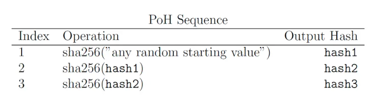

# 4 - Consensus

# 区块链的扩展性问题

比特币和以太坊在处理大量交易时存在可扩展性问题。三个主要方面：

1. **吞吐量低：** 每秒钟能够处理的交易数量（Transactions Per Second, TPS）太少。比特币大约是 7 TPS，以太坊大约是 15-30 TPS。这远远不能满足全球用户的使用需求。
2. **交易延迟高：** 交易从提交到被确认所需的时间很长。比特币的区块时间是 10 分钟，以太坊大约是 13 秒。在网络拥堵时，这个延迟还会急剧增加。
3. **交易费用高：** 当网络拥堵时，为了让交易能够被优先打包，用户需要支付更高的费用（Gas Fee），这使得小额支付变得不切实际。

# Proof of History

2017年 Anatoly Yakovenko 发布的 **Solana 白皮书** 中，提出了他称之为 Proof of History 的时间戳技术，用于解决可扩展性问题。

想象你需要证明自己曾在某个特定的时刻出现在某个地方，方法可能是出示一个带有时间戳的收据，或者依赖某人的证词。但这些方法存在可信度问题，比如收据可能被篡改，证词可能作假。更好的方式是拍一张带有当天报纸头条的照片，照片不仅仅证明你出现在那儿，还能证明你在那份报纸发布之后的某个时间点在场。这张报纸照片的威力在于，它将一个**无法篡改的、公认的事件序列（报纸发行）与你的存在锚定在了一起**。它创造了一个不可否认的因果链：先有报纸，后有照片，其顺序无法被倒转，这正是 Solana 的核心创新 **历史证明（Proof of History, PoH）**所要达到的目标。

💡

> 比特币创世区块的上链时间为2009年1月3日，中本聪将当天英国《泰晤士报》头版的标题 The Times 03/Jan/2009 Chancellor on brink of second bailout for banks 嵌入了创世区块的 coinbase 字段。
> 

传统区块链如比特币和以太坊，在生成区块时，就像一群人各自带着手表在工作。他们需要不断地相互沟通，以确保所有人都认同最终的区块顺序。这种耗时的协商过程，正是导致交易速度缓慢和可扩展性受限的根本原因。Solana 的 PoH 机制则为整个网络提供了一个**全局性的、无需信任的密码学时钟**。在 POH 中，使用 VDF 生成一个时间戳序列，每个时间戳都依赖于前一个时间戳，因此创建了一个可验证的事件链。

## VDF

**Verifiable Delay Function，**即可验证延迟函数，是生成不可篡改、连续时间序列的核心密码学工具。其名字中的 Verifiable Delay 指的是一种特殊的计算特性：

1. **Delay - 需要消耗时间计算：** VDF 的计算过程是**串行且耗时**的。这意味着即使你有强大的并行计算能力，也无法显著缩短计算所需的时间。它就像一个必须要一步一步完成的迷宫，没有捷径。这是 PoH 能够作为密码学时钟的根本原因。它确保了时间无法被加速。
2. **Verifiable - 易于验证：** 一旦 VDF 的计算完成，其结果可以被**非常快速地验证**。任何人都可以轻松地检查这个结果是否正确，而无需重新进行耗时的完整计算。这使得任何节点都可以独立地验证 PoH 序列的正确性，而无需信任任何特定的领导者。

**POH** 机制通过**连续迭代哈希函数（SHA-256）**的方式，来完美地实现 VDF 的“计算耗时”和“快速验证”这两个关键特性。其工作流程如下，

- 初始值：从一个随机数开始进行哈希运算。
- 循环哈希：将上一次哈希运算的输出作为下一次哈希运算的输入，重复这个过程。
- 记录：每一次哈希运算的次数和结果都会被记录下来。
- 形成证据链：迭代次数起到了“时间计数器”的作用，将这些哈希输出串联起来，形成一个完整的证据链，这个证据链的长度代表了时间的流逝。



该哈希链只能单线程顺序计算，无法平行加速。例如：要得到第 300 次哈希的结果，就必须从第 0 次开始，实际运行 300 次计算。因此，迭代次数就成为时间的代理———表示时间经过了多少单位。也就是说，在 Solana 中时间的流逝并不是通过计算时间来衡量的，而是通过计算SHA-256 哈希运算的数量来衡量的。每次生成一个新的哈希，就相当于在时钟中走了一步。

# Leader and Validator

在 Solana 的系统架构中，Validator（**验证者）**是 Solana 网络中负责维护和运行区块链的核心角色，要成为 Validator 需要同时满足：

- **运行 `agave-validator` 软件**：默认不会保留整个历史账本。
- **质押 SOL（Stake SOL）**：需要抵押一定数量的SOL代币作为保证金。质押的代币数量决定了节点被选为 Leader 的概率。**质押代币越多的节点，被选中的机会就越大**。另外，在验证新区块时，每个 Validator 的投票权重也与其质押的代币数量成正比。

## Leader - 区块生产者

在一个区块生成周期（Slot）内，只有一个 Validator 节点被选中担任 Leader。Leader 的角色是**交替轮换**的，这意味着网络中的不同 Validator 节点都会有机会被选为 Leader。

### Leader Schedule

在 Solana 中，区块的生产不是随机的，而是有计划的。其使用 **Leader Schedule（领导者排程）**详细列出了在未来的一个特定时期内（**Epoch**），网络中所有验证者在哪个时间段（**Slot**）被选为 Leader，即，Leader Schedule 为每个 Slot 指定一个唯一的验证者来担任 Leader。

- **Epoch**：一个较长的时间周期，通常持续约 2-3 天。
- **Slot**：一个非常短的时间片，大约为 400 毫秒。一个 Epoch 由许多 Slot 组成。

这个排程是根据 **Proof of Stake (PoS)** 机制计算出来的，具体来说：

1. **权益决定**：每个验证者质押的 SOL 代币数量决定了他们在排程中的权重。质押的 SOL 越多，被选为 Leader 的次数就越多，其在排程中占据的 Slot 也就越多。
2. **公开和可预测**：Leader Schedule 在一个 Epoch 开始时就被确定并广播给整个网络。这意味着，所有节点（包括 RPC 节点、验证者和用户）都能提前知道在接下来的几天里，谁将在什么时候生产区块。
3. **确定性**：由于这个排程是确定性的，它消除了传统区块链中区块生产的随机性，从而带来了巨大的效率提升。

### 交易传播

在 传统区块链（如比特币或以太坊）中，交易一旦被用户发起，会通过 **广播机制** 传播到整个网络。而 Solana 是 **directed transaction forwarding（定向交易转发）**。

- 用户创建并签名一个交易，并通过 RPC 节点从区块链网络中获取一个 recent_blockhash，该值用来确保交易的新鲜度和有效性。

💡

这个值是网络中 confirmed 状态（还没有达到 finalized 状态，也就是已确认但还未被最终确认）的最新区块的哈希。确切的说该哈希是当前 slot 的前一个已完成的 slot 中的最后一个 Entry 的 POH 时间戳。

- 当用户提交一笔交易时，这笔交易首先会发送到他们连接的 **RPC 节点**。RPC 节点是连接用户和区块链网络的接口节点，负责接收来自用户（客户端）的交易请求。
- RPC 节点收到交易后，会进行基础验证（检查签名有效性、账户余额、recent_blockhash 等）。验证通过后，RPC 节点会根据公开的 **Leader Schedule** 确定当前时隙（slot）的 Leader 是谁。
- RPC 节点随后将交易**直接发送**到当前 Leader 的 TPU（Transaction Processing Unit）端口，同时为了提高成功率，也会将交易发送给接下来的 2-3 个即将成为 Leader 的验证者。这种冗余发送机制确保即使当前 Leader 错过交易，后续的 Leader 也能及时处理。

这个用在中继节点和当前/未来领导者之间的定向交易转发，就是 **Gulf Stream**。Gulf Stream 是 Solana 的核心创新之一，它是一种 **无 mempool** 的交易转发协议，RPC 节点将收到的交易 **直接发给当前和即将成为领导者的验证者，交易并不会扩散到全网**。而在比特币、以太坊中，交易会进入节点的 mempool，然后节点通过 **Gossip** 协议将交易广播给邻居节点，最终扩散到全网。Gossip 协议是一种点对点的通信方式，每个验证者会持续地把新的交易信息与它的邻居节点分享，这样可以让新的数据在整个网络中极快且高效地传播。

### TPU

当一个 Leader 节点收到来自网络的交易时，其 TPU（Transaction Processing Unit）将负责执行交易、构建区块并向所有验证者进行广播。TPU 的几个关键阶段：

- **Fetch stage：**从网络中接收交易。
- **SigVerify stage：**对交易签名进行验证。
- **Banking stage：**执行交易，更新账户状态。
- **Broadcasting stage：**广播到网络中的其他验证者，以便进行验证和共识。

### Banking stage

Leader 在自己的 Slot 开始时，它会立即启动自己的 POH 进程，开始连续生成哈希。通过不断对前一次哈希结果执行SHA-256产生新的哈希值，序列为：

$$
H_1=SHA256(seed), H_2=SHA256(H_1), ⋯
$$

上面的 $H_1$ 表示创世区块的第一次哈希运算，其基于一个预设的初始种子值 seed。Leader 不断地运行 POH 哈希运算，为网络提供一个持续且可验证的心跳。

Solana 设计中，1 次迭代运算约耗时 0.48 微妙，约 200 万次哈希计算对应现实中的 1 秒。Solana 中并不会将所有这些迭代运算都记录下来，而是引入了 **Tick** 作为其时间单位。每个 Tick 对应 1.28 万次哈希计算，同时 Solana 中规定每个 Slot 包含 64 个 Tick，每个 epoch 由 432000 个 Slot 组成。可以做如下的估算，

- 每个 Slot 中大约为 400 毫秒。每个 Slot 有 $12800×64=819200$ 次哈希计算，从而可以推得每个 Slot 的时间大约为 $819200/2000000=0.4096$ 秒。
- 每个 Tick 大约为 $400毫秒/64=6.25毫秒$。
- 每个 epoch 大约为 $\frac{432000*400毫秒}{1000*3600}=48小时$。

Solana中没有传统意义上 **整块区块** 的概念，数据的单位是 Entry，而区块是一个抽象的概念，它是一组连续的 Entry。在每个 Slot 中 Leader 负责该 Slot 内的数据生产。对于每一个 Tick，

- 在其结束时都会生成 1 个 Empty Entry（称为 Tick entry），该 Entry 内不包含交易，只是作为 POH 链中的一个可验证的检查点，明确标识该 Tick 的结束时间点。
- 只要当前的交易数量达到 64 笔，Leader 就会立即创建 1 个 Entry（称为 Transaction-filled Entry）。如果当前网络中的交易负载很高，就能够快速的填满 64 笔交易，也就意味着 1 个 Tick 内可以连续生成多个 Entry。

对于一个 Slot 而言，由于每个 Slot 包含 64 个 Tick，每个 Slot 至少会产生 64 个 Entry。

一个 Entry 包含三个主要信息：

- **hash**：该 Entry 的 POH 哈希值。其计算方式分为有交易和无交易两种。
- **num_hashes**：自上一个 Entry 创建以来执行的 SHA-256 哈希迭代次数。表示两个相邻 Entry 之间的时间间隔。
- **transactions**：一组最多包含 64 个交易的列表。这个列表可以是空的。

举个例子，

Tick #1 仅有一个 Tick Entry

Tick Entry

- num_hashes = 12,800
- 这说明自从上一个 Tick 结束后一直进行哈希递归，直到满满地完成了 12800 次哈希，生成了一个 Tick Entry，这表示这一个 Tick 时间内没有任何交易。

Tick #2 有一个 Transaction Entry 和一个 Tick Entry

Transaction Entry

- num_hashes = 3,200
- 新的 Tick 开始后，Leader 继续哈希递归。在进行了 3200 次哈希之后，产生了一个 Entry。

Tick Entry

- num_hashes = 9,600
- Leader 继续从 Entry #2 的状态递归执行哈希，直到 Tick 结束，也没有任何交易，于是就产生了一个 Tick Entry，此时的迭代次数为 $12800 - 3200 = 9600$。

Leader 会将接收到的交易进行分组，并在本地的区块链状态副本上执行这些交易。然后将这些交易打包打包进 Entry。**对于执行失败的交易也会包含在 Entry 中且标记为失败**。这样网络中的 validator 能否看到所有提交的交易及其执行结果（成功或失败）。

每一个 Entry 都被记录到 POH 链中，

1. Leader 首先会打包一个 Entry 对象。
2. 然后对这个 Entry 进行哈希处理，得到该 Entry 的独一无二的“指纹”或“哈希值”。
3. 将当前 Entry 烧录到 POH 链中。
    
    ```json
    ... -> SHA256(上一个POH哈希) -> SHA256(上一个POH哈希 + **当前Entry的指纹**) -> ...
    ```
    

正常情况下 POH 的每一次哈希运算都会基于上一个计算结果进行计算，但是当把一个 Entry 烧录到 POH 链中时，会把 Entry 的指纹也作为输入。

$$
H_{i+1}=SHA256(H_i + hash(Entry))
$$

POH 链是指一个**连续、不可中断的哈希运算流，是一个抽象**，并不是真实存在。**Entry 是 POH 链的具象化**，可以把 Entry 看作 POH 哈希流中的具体记录点和数据锚点。POH 中的每一次迭代运算都是一次跳动，但这些跳动本身并不会被记录在链上。下面就是 Solana 中的区块链的具象化：

```
PoH_hash_1 -> PoH_hash_2 -> ... -> PoH_hash_N -> SHA256(PoH_hash_N + Entry_1) = PoH_hash_(N+1) -> PoH_hash_(N+2) -> PoH_hash_(N+3) -> ...
```

其中 `PoH_hash_1, PoH_hash_2, …, PoH_hash_N` 这些都代表了一次哈希运算，并不会写到链上。只有带有 Entry 的 `SHA256(PoH_hash_N + Entry_1)` 才会被写到链上。Entry 中的 `num_hashes` 字段记录了 **从上一个 entry 记录的点** 开始的哈希迭代次数。Entry 中的 `hash` 字段记录的是当前 Entry 的 POH 哈希值，对于 Tick Entry 的计算方式是 `SHA256(上一个POH哈希)`，而对于有交易的 Entry 的计算方式是 `SHA256(PoH_hash_N + Entry_1)`。

### 流式广播

Leader 并不是一次性打包所有 Entry 再广播，而是使用了高效的 **Turbine** 分层广播协议来广播数据。

- **分片（Sharding）：**当 Entry 被写入到 POH 链中后，就开始广播这个 Entry。Leader 会将它拆分成碎片（Shreds），并为这些碎片增加纠删码冗余数据，保证部分数据丢失时可以恢复。
- **Turbine 树：**Solana 网络的 Validator 节点被组织成一个多层次的树形拓扑结构，把数据通过多层中继迅速分发到所有参与的验证节点。验证节点根据其在 Turbine 树中的位置（可能是树的中间层节点，也可能是叶子节点）承担相应的转发职责，并下载、重组完整的Entry数据。无论节点处于哪个层级，它们收到完整Entry后都会验证和执行交易，参与共识投票。
- **分步广播：**Leader 节点首先将不同的碎片分别发送给 Turbine 树中第一层的 Validator 节点（每个 Validator 只接收一部分碎片）。这些 Validator 节点收到碎片后，再继续将其转发给自己在树下一层的子节点。每个节点只需处理和转发自己收到的碎片的那部分数据，而不需要完整转发整块数据。通过这种分片且分层的转发，整个网络中的所有节点最终都能收到所有 shreds。
- **数据恢复：**Validator 只需收到超过一定阈值（阈值低于总碎片数）的碎片数量，就可以利用纠删码算法恢复出完整的 Entry 数据。恢复出完整 Entry 后，Validator 才能对 Entry 进行完整的交易验证和应用。

## Validator - 区块验证者

- **实时广播：**当前 Slot 的 Leader 在生成每个 Entry 时，会实时地将其广播给验证者。这种传输是持续且实时的，验证者一直监听并接收来自 Leader 的 Entry。
- **接收并缓存：**Validator ****收到 Shreds 后，先在内存中缓存。一旦 Entry 完整立即开始验证执行。
- **流式重组：**Validator 实时接收来自 Leader 的 Shreds，并使用纠错码技术将 Shreds 重组为完整的 Entry。一旦重组出完整的 Entry，Validator 立即开始处理，无需等待该 Slot 内的所有 Entry 都到达。
- **并行执行：**Validator 对每个完整的 Entry 立即进行验证和执行，通过 **Sealevel** 运行时并行处理多个 Entry 中的交易，实时更新本地账本状态。如果某个 Entry 中的交易无效，该 Entry 会被标记为无效，但不会阻止其他有效 Entry 的处理。
    
    并行处理管道：
    
    ```
    T1: Entry#1 完整 → 开始验证执行 Entry#1
    T2: Entry#2 完整 → 开始验证执行 Entry#2 (同时 Entry#1 还在执行)
    T3: Entry#3 完整 → 开始验证执行 Entry#3 (Entry#1, #2 并行执行)
    ```
    

### Block

Block 是一个 slot 内所有 entry 的集合，用于共识决策（投票对象）。

```rust
Entry {
    num_hashes: u64,           // 从上个 entry 到当前 entry 的 PoH 推进次数
    hash: Hash,                // 该 entry 的 PoH 哈希值  
    transactions: Vec<Transaction>  // 该 entry 包含的交易列表
}

Block {
    slot: u64,                 // slot 编号
    entries: Vec<Entry>,       // 该 slot 内的所有entries
    blockhash: Hash,           // 区块哈希（通常是最后的 entry 的 PoH 哈希）
    parent_hash: Hash,         // 前一个区块的哈希
    // 其他元数据...
}
```

Block Hash 是该 slot 中最后一个 Entry 的 `hash` 字段的值（也就是 Tick Entry 的 PoH 哈希）。

### Tower BFT

Tower BFT 是一种对传统拜占庭容错（BFT）共识算法的优化算法，它利用 Solana 的历史证明（PoH）来实现快速且高效的共识，而无需传统 BFT 系统中的通信开销。

每个验证者不断接收区块并检查其有效性。理想情况下，所有的验证者看到的区块链应该是相同的。但现实是，

- 网络中有成千上万的参与者。
- 网络拓扑结构复杂，并非所有的区块都能传递到每个验证者。
- 恶意行为是可能的——包括攻击、混淆尝试或试图更改链的行为。

因此，不同的验证者在同一时间看到的区块链可能会不同。例如，验证者 X 可能没有收到 Slot N 的区块，而验证者 Y 却收到了。验证者 X 会认为 Slot N 的 Leader 错过了其轮次，而验证者 Y 会将该区块放到其链中。为了解决这些问题，Solana 使用了 Tower BFT 的共识算法。

在 Tower BFT 中，验证者通过投票来表示对某个 **区块** 状态的认可。验证者只有在满足以下所有条件时才会进行投票：

- 已接收并验证足够的 Shreds 来重组关键的 Entry
- 已并行执行足够数量的 Entry 来评估整个区块的有效性
- 已确认这个区块所在的 Fork 是当前网络中最重的分支
- 本地账本状态更新与网络大多数节点保持一致
- lock-out 约束允许

验证者将创建一笔特殊的投票交易（voting transactions），内容包含该 Slot 的编号和该 Slot 最后一个 Entry 的 POH 哈希，该哈希用于证明投票是针对完整的区块。验证者对投票交易进行签名后，将其广播到网络中。投票交易和常规交易一样，由 Leader 打包进区块。由于投票频率高且必不可少，实际每个区块里包含的交易中，投票交易占比较大。

验证者对某个区块的投票交易，理想情况下会被打包到该区块的下一个区块中，但实际网络条件或者 Leader 行为可能导致投票交易被延迟打包，出现在更加后续的区块中，这属于正常现象。

验证者需要为每笔投票交易需要支付 0.0005 SOL。由于 Solana 网络出块非常频繁，验证者每天会产生大量的投票交易。累计下来，平均一个验证者每天在投票上会花费约 1.1 SOL。为了鼓励验证者参与投票，Solana 设计了奖励机制，如果验证者投票支持的区块最终成为链中的一部分（被共识确认），那么验证者会得到相应的奖励。验证者虽需支付一定费用，但从长远看，通过参与共识获得的奖励远超支付的费用。

Solana 中区块的状态使用 commitment levels（承诺级别或确认级别）来描述，表示网络对该区块确认度的不同阶段。这些级别反映了区块在区块链上的不可逆性的强弱，是用来判断交易可靠性的重要依据。注意，**交易的状态不完全等同于其所在区块的状态**。

有三种承诺级别：

1. **Processed（已处理）**
    - 这个状态是 **节点本地** 的概念，而不是全网的概念。**`processed`** 的语义是 **本节点已处理过**。
    - 在 1 个 Slot 中，Leader 接收交易并执行，然后将交易打包进 Entry，1 个 Slot 中会产生多个 Entry，当该 Slot 结束时，所有这些 Entry 形成一个完整的 Block。
        
        ```
        Slot N (400-800ms duration):
        ├── Entry 1: [tx1, tx2, tx3] + PoH hash
        ├── Entry 2: [tx4, tx5] + PoH hash  
        ├── Entry 3: [tx6, tx7, tx8, tx9] + PoH hash
        └── ... more entries
        
        Slot N ends → Block N ready
        ```
        
    - Leader 在 1 个 Slot ****内不断通过 Turbine 传播 Shreds，各个节点（validator, rpc, archive）**边收边重放**。当你所查询的那个 RPC 节点已经重放了包含某交易的 Entry，在这个节点中该交易的状态在逻辑上就是 `processed`，查询这笔交易的状态时就可能返回 processed，而不必等 Slot 结束。之所以使用 **可能**，是因为不同 RPC 接口的元数据落盘/索引可用时机、分叉切换以及节点的暴露策略会影响你当下是否查得到。
    - 当你所查询的那个 RPC 节点把某个 Slot 的 所有 Entry 连续重放到最后一个 Tick Entry，这个节点就形成了该 Slot 的**完整区块**。此时 **在该节点的语义里**，`getBlock(slot, {commitment:"processed"})` 理应可以返回。
2. **Confirmed（已确认）**
    - 该区块已获得代表至少 66% 总质押的验证者的投票，网络对该区块已经达到高度共识。在大多数实际情况下，用户的交易在此阶段可以被视为已确认。虽然极不可能，但该区块仍有可能被回滚。

        💡
        
        假设网络中总共有 100 SOL 被质押，代表至少 66% 总质押意味着投票的验证者的质押总数必须超过 66 SOL，也就是超过 $\frac{2}{3}$。
        
        验证者 A 质押了 40 SOL，验证者 A 质押了 30 SOL，验证者 C 质押了 20 SOL，其他验证者质押了 10 SOL。此时如果 A 和 B 投票，则由于 $40+30=70$ 超过了所需的 66 的门槛，那么被投票的区块的状态就是已确认的。

3. **Finalized（最终确定）**
    - 这是最高级别的确认，区块不仅获得代表至少 66% 总质押的验证者的投票支持，还至少有 31 个状态为已确认的区块构建在其之上。一旦区块被最终确定，它被视为不可逆转的，网络将该区块作为账本的永久部分。任何验证者如果尝试投票支持不包含该区块作为祖先的其他分叉，都将违反共识规则。

lock-out 是 Tower BFT 中用来防止验证者在不同区块链分叉之间跳来跳去的关键机制，可以将其理解为一个承诺期或锁定期。

当一个验证者为某个区块投票时，这个投票不仅是对该区块有效性的确认，更是一个承诺。这个承诺附带一个 lock-out 期，在此期间，该验证者不能为任何与其投票区块不相容的分叉（fork）投票。如果验证者在 lock-out 期间违背了这个承诺，它将面临惩罚（slashing），即失去部分或全部的质押。可以把 lock-out 期理解为验证者投票后的一段禁止返回的时间段，该时间段以 Slot 计算。

lock-out 的时长并非固定不变，而是根据验证者连续在同一条链上投票的次数呈指数级增长。这就是 Tower BFT 中 “Tower” 这个词的由来。

举个例子，假如验证者连续投了以下票，

- **投第 1 票：Slot 10**，锁定期为 1 个 Slot
- **投第 2 票：Slot 11**（基于 Slot 10 的后继区块），锁定期增长到 2 个 Slot
- **投第 3 票：Slot 12**（基于 Slot 11 的后继区块），锁定期增长到 4 个 Slot

这意味着，在接下来的锁定时间（4 个 Slot），验证者**不能对与 Slot 10、11、12 发生冲突的分叉投票**，也就是说不能去投那些不继承 Slot 10、11、12 的分叉链，否则将违反锁定规则。验证者如果强行投票给冲突链，可能会被处罚。

当验证者发现它所在的链是错误的，而有一条更长、获得更多质押支持的“主链”存在时，它面临一个重要的选择：

- 选择继续在错误链上：如果它继续投票，它的 lock-out 会继续累积，但这条链最终会被抛弃。
- 选择回到主链：要回到主链，验证者必须开始为主链上的新区块投票。然而，由于它处于 lock-out 状态，这将违反锁定规则。

Solana 允许验证者在发现错误后回到主链，但这是有代价的。这些代价主要分为两种：一种是直接的经济损失，另一种是间接的信誉损失。

---

[返回课程首页](../../README.md)
