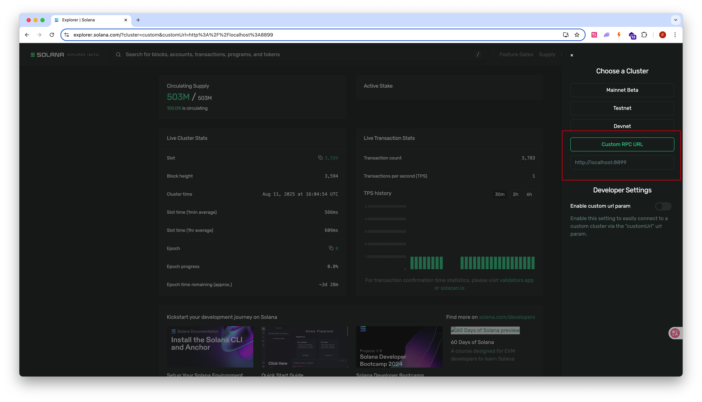

# Anchor CLI

# 创建

```bash
anchor init --test-template mollusk my-first-program
```

创建一个名为 `my-first-program` 的 Anchor 项目，并使用 **Mollusk** 测试模板。

`anchor init` 会创建一个新的 Anchor 项目，生成默认的目录结构。

`--test-template` 用来指定测试代码的模板。

- `mocha`（默认值）
    
    生成基于 **Mocha + Chai** 的 TypeScript 测试模板。
    
- `jest`
    
    生成基于 **Jest** 的 TypeScript 测试模板。
    
- `rust`
    
    生成 **solana-program-test** 的测试模板。
    
- `mollusk`
    
    生成基于 **Mollusk** 的测试模板。
    

**Mocha** 和 **Jest** 是两个 TypeScript / JavaScript 测试框架，运行在 Node.js 环境中。**Mocha** 负责组织和运行测试用例，需配合其他断言库如 **chai** 一起使用。**chai** 是一个流行的 JavaScript 断言库，支持多种断言风格（assert、expect、should），提供链式调用，表达简洁且易读。

**Jest** 是由 Facebook 维护的开箱即用的测试框架，内置断言、模拟、快照测试和覆盖率报告等，配置简单，是更现代的测试框架。从社区和实际项目的使用频率来看，**Mocha + Chai** 组合在 Solana 合约测试中使用较多，**Jest** 采用略少，更多用于前端或通用的 TS / JS 项目。

**Mocha** 和 **Jest** 都仅仅是测试框架，并不包含 Solana 区块链环境，都依赖 `solana-test-validator` 作为区块链运行环境。执行 `anchor test` 时会自动在当前测试进程内启动一个 validator，也可以手动在一个单独的进程中启动一个 validator，其区别是前者是一个临时环境，而后者是一个持久化环境。

**Mocha** 和 **Jest** 在 Solana Anchor 项目中进行测试时，都会用到 `@coral-xyz/anchor` 这个库。`@coral-xyz/anchor` 是 Anchor 框架的官方 TypeScript / JavaScript 客户端库，基于 `web3.js` 封装，提供了与 Solana 区块链交互的高层抽象接口，封装了程序的调用、交易构建、账户管理、钱包连接等功能，让开发者可以方便快捷地从前端或测试代码中调用 Anchor 写的 Solana 程序。

**solana-program-test** 是 Solana 官方提供的 Rust 测试框架，其会在 **当前测试进程中** 启动一个轻量的 Solana 运行环境。几乎完整还原了 Solana 的运行环境。

**Mollusk** 和 **solana-program-test** 一样，也是在当前测试进程中启动临时环境。但 Mollusk 更加轻量级，它通过直接调用 Solana 虚拟机（SVM）组件，省去了完整验证器中的重型模块（如 AccountsDB 和 Bank），没有完整的链状态管理，因此启动速度更快，测试执行更高效。但也因此需要测试者显式创建和管理账户状态。

**solana-program-test** 和 **Mollusk** 均不支持持久化环境，测试结束即清理环境。重新启动测试时，都会从全新、干净的环境开始。

# 构建

```bash
anchor build
```

构建你的 Solana 程序。

# 测试

```bash
anchor test
```

在本地启动一个 Solana 测试环境，并自动完成从构建、部署到运行测试的全过程。

1. **启动本地 Solana 验证节点**：
    - 自动运行 **solana-test-validator**，在当前进程启动一个单验证节点。
2. **构建和部署程序**：
    - 构建你项目中的 Solana 程序，并将构建好的程序部署到验证节点上。
3. **运行测试**：
    - 查找 `tests` 文件夹中的测试文件，并运行这些测试。
4. **停止本地 Solana 验证节点**：
    - 测试完成后，自动停止本地的 Solana 验证节点。

可以 **手动启动** 这个验证节点，并让它保持运行，以便在进行多次程序迭代时，可以持续运行验证节点，避免每次测试时都启动新的节点。

打开一个新的终端窗口，手动运行以下命令来启动 **Solana 本地验证节点**：

```bash
solana-test-validator
```

在运行 `anchor test` 时，需要 **跳过自动启动验证节点**：

```bash
anchor test --skip-local-validator
```

注意，上面的流程对于使用 Mocha 或 Jest 测试框架时是适用的，但是对于 solana-program-test 和 mollusk 两个测试框架，它们都会使用自带的 Solana 运行环境。注意的是，即便 solana-program-test 和 mollusk 有自己的 Solana 运行环境，使用 `anchor test` 这个命令启动测试时，依然会自动启动 solana-test-validator。但可以使用 `anchor run test` 这个命令来启动测试，从而避免启动 solana-test-validator。

# Solana Explorer

可以使用 Solana Explorer 来检查本地验证节点的状态。Solana Explorer 是一个基于 Web 的工具，设计为支持多种集群的，即你可以将它指向任何 RPC 端点。以下是如何打开 Solana Explorer 并将其连接到本地验证节点的步骤：

- 需要启动本地的 Solana 验证节点。在一个新的终端窗口中手动运行 `solana-test-validator`
- 在浏览器中打开官方的 Solana Explorer 网站：[https://explorer.solana.com](https://explorer.solana.com/)
- 连接到你的本地验证节点，默认情况下，Explorer 是连接到 **Mainnet-Beta** 集群的。要将其切换到你的本地验证节点，你需要更改集群设置。
    1. 在页面右上角找到一个下拉菜单，默认显示为 "Mainnet Beta"。
    2. 点击下拉菜单。
    3. 在集群列表中选择 **"Custom RPC URL"**（自定义 RPC URL）。
    4. 会出现一个新的输入框。在该框中输入你本地验证节点的 RPC URL（步骤 1 中提到的 URL）。对于标准设置，这通常是：`http://localhost:8899`。



---

[返回课程首页](../../../README.md)
