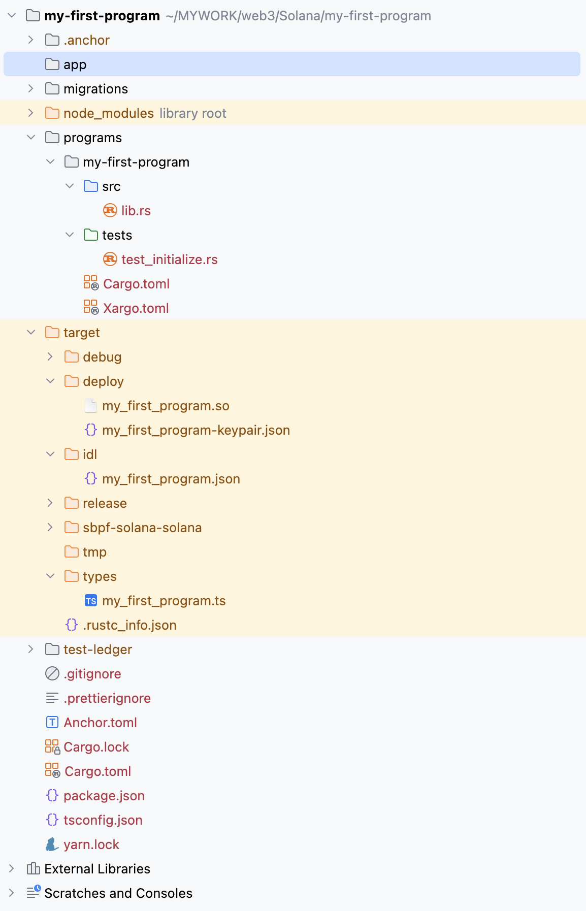

# 项目结构

下面的截图中使用的是 RustRover IDE，也可以使用 Visual Studio Code。



**.anchor**：Anchor CLI 的工作目录，是 Anchor CLI 在执行命令时生成和使用的。

- **`program-logs/`**：日志流订阅的标记文件的存放目录。
    
    Anchor 会为每一个正在监听的 program 生成一个对应的 `.log` 文件，标识 Anchor 当前正在监听这个 Program，这是 Anchor CLI 的一种内部机制，用文件来标记 **日志流已启动**，即 Anchor 已经开始订阅和这个 Program ID 相关的交易日志了。
    
- **`test-ledger/`**：运行 `anchor test` 命令进行本地测试时，用来存放账本数据的目录。每次运行测试时都会覆盖，保证测试环境从干净状态开始。

**app**：这个目录通常用于客户端应用程序，它与 Solana 程序交互。比如，它可以是一个 Web 应用（例如 React 或 Next.js 应用），它调用你链上程序中定义的函数。

**migrations**：这个目录是 Anchor 存放部署脚本的地方，这些脚本通常用 TypeScript 编写。当运行 `anchor deploy` 命令时，Anchor 会查找并执行这个目录下的脚本。

**programs**：这是链上代码的最重要的目录。它存放着 Solana 程序的源代码。

- **my-first-program**：这是一个具体程序的子目录。
    - **src**：Rust 程序的源代码目录。
        - **lib.rs**：创建的是一个 **`lib` crate**，而不是一个 **`bin` crate**。
            
            Solana 的链上程序本质上就是一个库。
            
            Solana 程序不是由你手动运行的。它们是在 Solana 链上由一个特殊的 **BPF (Berkeley Packet Filter)** 虚拟机加载和执行的。BPF 虚拟机本身就是“主程序”，它会调用你程序中的特定函数。因此，你的程序不需要 `main` 函数。
            
            你的 Solana 程序需要向 Solana 运行时暴露一个公共接口，以便运行时可以调用它。`lib` crate 的设计模式正好符合这个需求。`lib.rs` 中使用 `#[program]` 和 `#[derive(Accounts)]` 等宏，将你的函数和数据结构编译成一个可供 Solana 运行时调用的库。
            
            最终，编译你的 `lib.rs` 和相关代码，生成一个 Solana 虚拟机可以加载的 `.so` (shared object) 文件。这个 `.so` 文件就是你的 Solana 程序。
            
    - **tests**：这个目录包含了 mollusk 相关的测试代码。用 JavaScript/TypeScript 编写的测试代码会放到项目根目录下的 tests 目录中。
    - **Cargo.toml**：这是你的 Rust 程序的包清单，指定了程序的元数据、依赖项和功能。
        
        ```toml
        [package]
        name = "voting"
        version = "0.1.0"
        description = "Created with Anchor"
        edition = "2021"
        
        [lib]
        crate-type = ["cdylib", "lib"]
        name = "voting"
        
        [features]
        default = []
        cpi = ["no-entrypoint"]
        no-entrypoint = []
        no-idl = []
        no-log-ix-name = []
        idl-build = ["anchor-lang/idl-build"]
        test-sbf = []
        
        [dependencies]
        anchor-lang = "0.31.1"
        
        [dev-dependencies]
        mollusk-svm = "0.4.2"
        solana-program = "3.0.0"
        solana-sdk = "2.3.1"
        bincode = "1.3.3"
        ```
        
        `[package]`
        
        定义了这个 crate 的基本元信息。
        
        | 字段 | 含义 |
        | --- | --- |
        | `name = "voting"` | 这个 crate 的名字，必须与 Anchor.toml 中 `[programs]` 对应键一致。也是部署后的 IDL 名称、TypeScript 客户端名称等的来源 |
        | `version = "0.1.0"` | 程序版本号，主要用于文档与 registry 版本管理。部署合约时没什么影响 |
        | `description` | 可选字段，用于文档/包管理器描述，不影响构建 |
        | `edition = "2021"` | Rust 编译器使用的语言版本标准，推荐使用最新版（如 2021）以启用新的语法与改进 |
        
        `[lib]`
        
        定义如何构建这个 crate 的库（library）。
        
        - `cdylib`：编译为 C-compatible 动态库，这是 **Solana BPF 合约的必须格式**
        - `lib`：普通的 Rust 库格式，用于本地测试（如 unit test）
        - `name = "voting"`：定义编译生成的库名称
        
        `[features]`
        
        可选功能特性（features），是一组条件编译的开关。这些特性通过 Rust 的条件编译机制被作用于代码中，有启用就编译对应代码，没有启用就忽略。
        
        其中的每一项，等式左侧是 feature 的名字，右侧的数组 `[]` 表示这个 feature 依赖于哪些其他 feature 或依赖项，可以为空。
        
        - 必须在 **构建命令中显式指定** 启用哪个 feature。
            
            ```rust
            cargo build --features my-feature
            // 或者
            cargo run --features my-feature
            ```
            
        - `#[cfg(feature = "...")]`
            
            **条件编译属性**，用来根据编译参数决定是否**包含一段代码**。
            
            ```rust
            #[cfg(feature = "my-feature")]
            fn do_something() {
                println!("my-feature 被启用了！");
            }
            ```
            
        
        | Feature 名称 | 含义 | 依赖 |
        | --- | --- | --- |
        | `default` | 默认启用的 features（此处为空） | – |
        | `cpi` | 用于跨程序调用（CPI）构建模式 | `["no-entrypoint"]` |
        | `no-entrypoint` | 禁用程序入口，作为纯库构建 | 无 |
        | `no-idl` | 不生成 IDL 文件（跳过 target/idl/*.json） | 无 |
        | `no-log-ix-name` | 不在日志中输出指令名，减少体积 | 无 |
        | `idl-build` | 触发 anchor-lang 的 IDL 生成流程 | `["anchor-lang/idl-build"]` |
        | `test-sbf` | 启用 BPF 测试相关逻辑（配合 mollusk） | 无 |
        
        `[dependencies]`
        
        项目的运行时依赖。
        
        `[dev-dependencies]`
        
        开发和测试时使用的依赖（不会被编译进最终字节码）。
        
    - **Xargo.toml**：这是一个由 Xargo 使用的配置文件，大部分情况下已经 **不再被用到**，保留下来只是为了 **向后兼容** 或 **避免老环境报错**。早期 Solana 工具链是基于 **Xargo** 来交叉编译 Rust 标准库给 `bpfel-unknown-unknown` 目标的，从 **Solana 1.8** 开始，官方工具链换成了 `cargo-build-bpf`（使用定制的 LLVM 和 rustc），不再依赖 Xargo。
        
        这个文件的内容如下，
        
        ```toml
        [target.bpfel-unknown-unknown.dependencies.std]
        features = []
        ```
        
        这个文件表示，在为 `bpfel-unknown-unknown` 目标编译程序时，使用一个没有任何额外特性的 `std` 标准库版本。其原因是，Solana 智能合约的运行于 BPF 虚拟机环境中，许多标准库的特性（例如，文件系统、网络或多线程）是不存在的。
        
        - `target.bpfel-unknown-unknown.dependencies.std` ：**针对 `bpfel-unknown-unknown` 目标，在构建时，我们需要特殊的标准库依赖配置。**
            - **`target`**: 这是 Rust 构建系统中的一个关键字，用于指定针对某个特定的目标平台进行配置。
            - **`bpfel-unknown-unknown`**: 这是 Solana 程序的**编译目标**（compilation target）。它是一个目标三元组（target triple），代表了：
                - **`bpfel`**: 处理器架构。`bpf` 指的是 Berkeley Packet Filter，它是 Solana 智能合约所运行的虚拟机（类似于以太坊的 EVM）。`el` 指的是**小端字节序（endianness）**。
                - **`unknown`**: 指的是供应商（vendor），通常在标准编译中用于指定 CPU 制造商。在这里，它是未知的，因为 BPF 是一种虚拟架构。
                - **`unknown`**: 指的是操作系统，同样也是未知的，因为 Solana 程序在一个**无操作系统（freestanding）**的环境中运行。
            - **`dependencies`**: 用于指定该目标平台所需的依赖。
            - **`std`**: 指的是 Rust 的**标准库（Standard Library）**。
        - `features = []`: 一个空数组，表示**不启用任何特性**。

        💡
        
        **目标三元组（Target Triple）**的作用是实现交叉编译，可以用一个平台上的编译器（例如，在 macOS 上）为另一个平台（例如，在 Linux ARM 服务器上）生成可执行代码。一个典型的 Target Triple 包含三个主要部分，以连字符分隔：
        
        1. **`architecture`** (架构)
            
            指定了代码将要运行的 CPU 架构。在 Solana 的上下文中，架构是 `bpfel`，表示 Berkeley Packet Filter 的小端版本，这是 Solana 智能合约所运行的虚拟机。
            
        2. **`vendor`** (供应商)
            
            指定了目标平台的提供商 / 厂商。在 Solana 的上下文中，供应商是 `unknown`，表示**非特定厂商的开源生态**。
            
        3. **`os`** (操作系统)
            
            指定了代码将要运行的操作系统。在 Solana 的上下文中，操作系统是 `unknown`，因为它运行在一个**无操作系统**的环境中。
            
        4. **`abi`** (应用程序二进制接口)
            
            可选，指定了在给定操作系统上，如何与代码进行交互的低级细节。这包括函数调用约定、数据类型大小和内存布局等。

**target**：这个目录是 **构建输出目录**。

- **debug**：存放程序的调试构建，通常用于本地测试。
- **deploy**：包含将程序部署到 Solana 区块链所需的最终部署文件。
    - **my_first_program.so**：编译后的链上程序。`.so` 代表 "shared object"（共享对象），这是 Solana 程序的可执行字节码格式。
    - **my_first_program-keypair.json**：程序的密钥对文件，存储了公钥和私钥，用于标识你在 Solana 网络上的程序。
- **idl**：这是接口描述语言（IDL）目录。IDL 是你程序公共接口的 JSON 表示，包括指令、账户和类型。它对于客户端应用程序与程序的交互至关重要。
    - **my_first_program.json**：包含你程序 IDL 的 JSON 文件。
- **release**：存放程序的优化版本，通常用于生产环境的部署。
- **sbpf-solana-solana**：存放 Solana BPF 编译器（把 Rust 代码编译成区块链虚拟机能运行的程序）相关的中间产物。
- **tmp**：构建过程中的临时目录。
- **types**：这个目录包含根据你程序的 IDL 生成的 TypeScript 类型定义文件，为你的客户端应用程序与链上程序的交互提供了类型安全的方式。前端 `@project-serum/anchor` SDK 可以直接 import 这些类型，避免手写接口。
    - **my_first_program.ts**：包含生成类型的 TypeScript 文件。
- **.rustc_info.json**：这是由 Rust 编译器在构建项目时生成的文件，用于存储关于当前 Rust 工具链和目标平台的**元数据**。这些信息对于构建工具来说非常重要。

**test-ledger**：这个目录也是用于存储账本状态，但它用于独立的测试验证器进程所使用的账本数据存储，即手动运行 `solana-test-validator` 这个命令时的账本数据。这里的数据是 **持久化** 的，每次启动 validator 时，会继续读取这里数据。

**Anchor.toml**：Anchor 项目的全局配置文件。

```toml
[toolchain]
package_manager = "yarn"

[features]
resolution = true
skip-lint = false

[programs.localnet]
voting = "9aeoZT1WyTfT9cXEEDyb32orFgPsXHpQmcthjGs5Z4qf"

[registry]
url = "https://api.apr.dev"

[provider]
cluster = "localnet"
wallet = "~/.config/solana/id.json"

[scripts]
test = "cargo test-sbf"
```

[toolchain]

配置 Anchor 项目使用的工具。

- `package_manager = "yarn`" 表示用 **Yarn** 作为前端的包管理器（也可以换成 `npm` 或 `pnpm`）。

[features]

配置 Anchor 构建过程中的可选功能。

- `resolution = true`：
    
    启用依赖项和功能的自动解析。
    
    在现代 Rust 和 Anchor 项目中，许多依赖项使用了条件编译特性（features），此项配置确保它们能被正确解析和启用，避免构建时出现缺失依赖或编译错误。
    
- `skip-lint = false`：
    
    当设置为 `false`（默认值）时，Anchor 会在构建之前运行 **Solana 的 BPF linter**，即 `cargo clippy` 的定制规则，帮助你检测潜在的危险代码（如 panic、unwrap 等）。
    
    如果设为 `true`，将跳过 lint 检查，这可能会加快构建速度，但可能遗漏关键的编译警告。建议保持为 false。
    

[programs.localnet]

为特定网络环境 `localnet` 配置程序名与其部署地址（program ID）的映射关系。

- `voting = "9aeoZT1WyTfT9cXEEDyb32orFgPsXHpQmcthjGs5Z4qf"`：
    - `voting` 是你在项目中定义的程序名，通常与 `programs/voting/Cargo.toml` 中的 `name` 字段保持一致。
    - 等号右边是该程序在本地网络中的公钥地址，也就是部署后的 Solana 程序 ID。
        
        当你运行 `anchor build` 或 `anchor test` 时，Anchor 会根据这个地址识别和部署你的合约。
        

可以为不同集群（如 devnet、mainnet）配置各自的 program ID，例如：

```toml
[programs.devnet]
voting = "Fxyz...123"
```

[registry]

配置程序地址注册表的来源。程序地址注册表是一个用于 **记录 Anchor 程序名称和其部署地址（即 Solana 上的 Program ID）之间映射关系** 的系统，从而使得我们可以使用程序名称来引用某个 Anchor 程序，而不需要手动填写冗长的 32 字节的公钥地址。

- `url = "https://api.apr.dev"`：
    
    这是 Anchor 官方提供的程序注册表地址，是一个公共数据库，保存了许多 Anchor 程序名与其地址的映射。
    
    注意，可以部署自己的私有注册表用于内部团队协作。
    

[provider]

配置与 Solana 区块链进行交互所需的**连接细节**。告诉 Anchor：要连接到哪个 Solana 网络？要使用哪个账户来签署事务？

- `cluster`
    
    指定你希望连接的 Solana 集群（Cluster）。其值是一个字符串，用于标识 Solana 网络的类型。可以设置为：
    
    - **`"localnet"`**: 这是默认值。它指的是一个本地运行的、临时的 Solana 测试验证器。这是进行开发和测试时最常用的选项，因为它提供了完全隔离和快速迭代的环境。
    - **`"devnet"`**: Solana 的开发网络。这是一个公共的测试网络，任何人都可以连接，但它上面的代币没有真实价值。它用于在公共环境中测试你的程序。
    - **`"testnet"`**: Solana 的测试网络。这是一个更稳定的、用于生产前测试的网络。
    - **`"mainnet-beta"`**: Solana 的主网。真实的、生产环境的网络，其中代币具有实际价值。
- `wallet`
    
    指定用于与 Solana 网络交互的钱包路径。`~/.config/solana/id.json` 是本地钱包文件的位置。这个钱包文件包含了与该网络进行交易的密钥对，包含公钥和私钥。Anchor CLI 会使用这个钱包对部署和测试交易进行签名。
    

[scripts]

定义了可以通过 `anchor run <script-name>` 执行的自定义脚本。

- `test = "cargo test-sbf"`：这定义了一个名为 `test` 的自定义脚本。当你运行 `anchor run test` 时，Anchor 会执行命令 `cargo test-sbf`，这个命令将测试编译为 SBF 格式并运行，这种设置适用于只使用 Rust 编写测试逻辑的项目，尤其是配合如 `mollusk` 等框架进行链上逻辑模拟测试时。而在默认情况下，Anchor 会运行根目录下的 `tests/` 目录中的 JavaScript 或 TypeScript 文件，并使用 Mocha 测试框架执行。

💡

**`anchor run xxx`**: Anchor 会去 `[scripts]` 中查找 xxx 并执行，找不到会报错。

**`anchor xxx`**: 用于执行 Anchor **内置（预定义）命令**。注意，如果在 `[scripts]` 中定义了一个与 Anchor 内置命令同名的脚本（比如 `test`、`build`），那么执行 `anchor xxx` 时，Anchor 会优先执行自定义的脚本，而不是 Anchor 的内置命令。

**Cargo.toml**：在 Rust 的世界里，`Cargo.toml` 是包管理器 Cargo 的清单文件。位于项目的根目录下的 Cargo.toml 定义了一个**工作区**。工作区是 Rust 包（crate）的集合，它允许你将多个相关的包组织在一起，并使用一个统一的命令来构建、测试和发布它们。

```toml
[workspace]
members = [
    "programs/*"
]
resolver = "2"

[profile.release]
overflow-checks = true
lto = "fat"
codegen-units = 1

[profile.release.build-override]
opt-level = 3
incremental = false
codegen-units = 1
```

[workspace]

表示这是一个 **Rust 工作区（Workspace）** 的根目录配置。

- `members` 指定当前工作空间包含的成员路径。
- `"programs/*"` 是一个 glob 通配符，表示 `programs/` 文件夹下的所有子目录都被当作独立的 crate 加入 workspace，每个子目录都应该包含自己的 `Cargo.toml` 文件
- `resolver` 设置 Cargo 的 **依赖解析器版本**，`resolver = "2"` 指定使用 Cargo 的第二个版本依赖解析器，启用的是**工作区感知的特性依赖解析（feature unification）**，主要优势：
    - 可以避免不同 crate 中的特性互相污染
    - 提升构建性能和依赖清晰度

[profile.release]

配置 **release 构建模式** 的行为（即 `cargo build --release` 时的行为）。

- `overflow-checks = true`
启用 算术溢出检查（比如 u64 加法溢出会触发 panic）。在 Solana BPF 合约中非常重要，可以防止严重漏洞（如绕过金额判断）。
- `lto = "fat"`
启用 Link-Time Optimization（链接时优化），值为 "fat" 表示对整个 crate 和依赖执行优化。可以极大减少 BPF 程序的最终体积（Solana 对体积有严格限制）。比 "thin" 优化程度更高，但构建时间更长。
- `codegen-units = 1`
将代码生成单元数量设为 1，使编译器把所有代码合并为一个优化单元进行优化。这样可以提升优化质量（比如跨模块内联），但牺牲并行构建速度。这对于 BPF 编译非常有帮助，尤其是减少最终字节码大小。

[profile.release.build-override]

为 build-dependencies 设置 release 构建策略。Rust 项目中有两种代码：

1. **库/程序代码（Your crate's code）**：这是你编写的实际代码。
2. **构建依赖（Build dependencies）**：这些是你的代码在编译时所依赖的库。例如，`solana_program`、`anchor-lang` 等。

在 Solana 的上下文中，通常会为**所有代码（主程序和所有依赖）都设置激进的优化**，因为最终生成的程序包非常小，而且 Solana 虚拟机对代码质量有很高要求。**`build-override`** 是为了明确地告诉 Cargo，即使是那些作为依赖而构建的代码，也应该应用这些严格的优化设置，而不是默认的、可能更快的构建策略。

- `opt-level = 3`
设置优化级别为 3，也就是 Rust 编译器的最高优化级别。用于追求最小字节码和最佳性能。
- `incremental = false`
关闭增量编译。增量编译对大型项目有益处，但对构建 Solana BPF 程序没意义，甚至会导致结果不一致。Anchor 项目通常推荐关闭它，确保构建产物稳定、干净。
- `codegen-units = 1`
与 [profile.release] 中一样，这里也设置为单一代码生成单元。

**Cargo.lock**：由 cargo 生成的文件，记录了你项目中所有依赖项的确切版本，确保可重复的构建。

**.gitignore**：标准的 Git 文件，指定哪些文件和目录应该被 Git 忽略（例如，`target`、`node_modules` 等）。

**.prettierignore**：一个文件，Prettier 代码格式化工具用来指定不应格式化的文件。

即便我们使用 `anchor init --test-template mollusk my-first-program` 命令创建的项目，并且指定了 mollusk 作为测试库，但生成的项目中仍然包含了与 Node.js 相关的文件和目录，从这些文件的内容可以看出，其作用是为了支持 **测试** 和 **部署** 这两个功能。默认的 TypeScript 测试环境仍然保留在项目中，可以在端到端测试时使用。

**node_modules**：这是 JavaScript/TypeScript 项目的标准目录，包含所有外部依赖和库。

**package.json**：Node.js 项目的配置文件，它定义了项目的元数据和依赖项。

**tsconfig.json**：TypeScript 编译器的配置文件，告诉 TypeScript 编译器如何编译项目中的 `.ts` 文件。

**yarn.lock**：由 Yarn 包管理器自动生成的文件，npm 也有一个类似的文件，叫做 `package-lock.json`。表明项目默认使用的包管理器是 **Yarn**。

[lib.rs](lib%20rs.md)

[宏](%E5%AE%8F.md)

[IDL](IDL.md)

---

[返回课程首页](../../../README.md)
