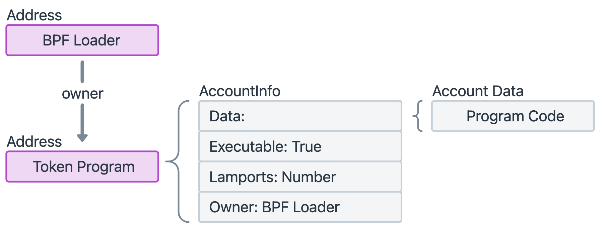

# 2 - SPL Token

代币（Token）是一种数字资产，其代表了对各种资产的所有权。从数字世界中的资产（如游戏内的物品）到现实世界中的资产（如房产、艺术品、股票），代币化就是将这些资产的所有权信息，以数字代币的形式放在区块链上。

区块链上的代币分为**同质化代币（Fungible Token）和非同质化代币（Non-Fungible Token）**。

- **同质化** 意味着任何一个代币都与另一个代币完全相同且可以互换。就像你口袋里的 10 元纸币，它的价值和另一个人的 10 元纸币完全一样，可以互相替换。
- **非同质化** 意味着每个代币都是独一无二的，拥有自己的唯一标识，不能被等价互换。它们代表的是特定且唯一的资产所有权。比如演唱会门票，你不能用前排票直接换后排票，因为两张票的价值、位置完全不同。

目前的加密领域中 **RWA** 正在迅速成为热点趋势。RWA 是 **Real World Asset (现实世界资产)** 的缩写，它指的是将现实世界中那些有价值的、有形或无形的资产，通过 **代币化** 的方式映射到区块链上，从而使它们能在去中心化的金融世界中进行交易、融资和管理。简单说，RWA 是连接传统金融世界与区块链世界的桥梁。

RWA 既可以使用**同质化代币**，也可以使用**非同质化代币**。如果一个资产可以被分割成完全相同的、可互换的单位，比如一栋楼的股份或一笔债务的份额，那么使用同质化代币。如果资产是独一无二的，不可分割或互换，比如一幅画、一件艺术品或一整套房产的所有权，那么使用 NFT 就能更好地代表其唯一性。

# SPL Token Program

在 Ethereum 上发行代币，你需要 **使用 ERC-20 或 ERC-721 标准来编写一个智能合约**，然后部署到以太坊网络上（ERC-20 是同质化代币标准，ERC-721 是非同质化代币标准）。而在 Solana 上发行代币，**不需要自己写代码**，因为 Solana 官方已经写好并部署了一个通用的程序 **SPL Token Program**。SPL Token Program 提供了一整套关于代币的操作逻辑，由 Solana 官方团队开发和维护，并且部署在所有 Solana 网络上（mainnet-beta、testnet、devnet）。



SPL Token Program 是 **Solana Program Library** 中的一个程序。Solana Program Library 是一组常用 Program，类似于以太坊的 OpenZeppelin 标准合约库，已经经过审计，并由官方团队写好并部署在各个网络上了。

SPL 中存在两个 Token Program。

- **Token Program**
    
    这是最早的 **SPL Token Program**，其程序地址是 `TokenkegQfeZyiNwAJbNbGKPFXCWuBvf9Ss623VQ5DA`。目前 Solana 上的主流代币如 USDC、USDT、RAY等都是基于这个 **Token Program** 实现的。
    
    主要功能包括：
    
    - 创建代币 (Mint)：创建新的代币发行账户。
    - 铸造 (MintTo)：向指定账户铸造（发行）代币。
    - 转账 (Transfer)：在账户之间转移代币。
    - 销毁 (Burn)：销毁代币，减少总供应量。
    - 授权 / 冻结 (Authorize / Freeze)：管理账户权限，冻结账户防止交易。
- **Token Extension Program (Token-2022)**
    
    官方在 2022 年提出的改进版，其程序地址是 `TokenzQdBNbLqP5VEhdkAS6EPFLC1PHnBqCXEpPxuEb`。改进版包含了**所有原始 Token Program 的能力**，增加了**扩展功能（extensions）**。这些扩展允许在代币上实现更多高级特性，例如：
    
    - **转账费**（每次转账自动收取一定比例费用）
    - **利息累积**（持有代币自动生息）
    - **元数据扩展**（附加更多信息，比如合规标识）
    - **永久冻结**（合约层面限制某些账户操作）
    - **转账限制**（白名单/黑名单控制）
    
    Token-2022 与 Token program 完全独立，互不依赖。Token-2022 是基于 Token Program 的代码扩展演化而来，但不直接依赖 Token Program 的 crate，而是维护了自己的版本。

💡

Token Program 和 Token-2022 在所有网络上的地址都是一样的。

SPL Token Program 实现和管理的代币是 **Solana 区块链上的通用代币标准。**注意，SPL Token 与 Solana 原生代币 SOL 不同，SOL 是 Solana 区块链的原生代币（native token），类似于以太坊里的 ETH 、比特币网络里的 BTC，主要用于支付交易费用、参与治理等，不依赖于 SPL Token Program。

## Mint Account

是 Token Program 中的 **数据账户**，存储一个代币的状态信息，是一个代币的 **身份证**。每创建一个 Mint Account，就代表发行了一种新的代币。Mint Account 存放了一个代币的全局信息，在该账户的 `data` 字段中存储了：

- **Supply**：当前已铸造的总量
- **Decimals**：小数精度，决定了代币可以被分割到多小的单位
- **Mint Authority**：谁有权利往某个代币账户（Token Account）中铸造新的代币
- **Freeze Authority**：谁有权利冻结某个代币账户（Token Account）中的代币


创建一个 SPL Token Mint Account：

- System Program
    - 负责在链上分配一个新的账户（存储空间 + rent + owner 设置）。
    - 调用的是 `system_instruction::create_account`。
    - 这一步只是造了个空壳，还不是 Mint。
    - 设置 `owner = SPL Token Program`
- SPL Token Program
    - 负责把这个账户初始化为 Mint 类型。
    - 调用的是 `initialize_mint` 指令（属于 `spl_token::instruction`）。
    - 设置字段：`mint_authority`、`decimals`、`freeze_authority`、`supply=0` 等。

## Token Account

是 Token Program 中的 **数据账户**，用来记录 **一个用户对一个代币的余额**。Token Account 存放了一个用户的余额信息，在该账户的 `data` 字段中存储了：

- **Mint**：这个账户是装哪种代币的，即，对应的 Mint Account 地址。
- **Owner**：这个账户是谁的，即，谁控制这个账户。通常是一个 **钱包账户（Wallet Account）**，但也可以是 **另一个程序（Program）的地址**。
- **Amount**：这个账户装了多少这种代币，即，余额。


上面的 **Owner** 字段代表了 **控制账户的实体**。这个实体可以是：

- **一个用户**：通过私钥来控制，这是最常见的情况。
- **一个程序**：通过其内置的逻辑来控制，这使得代币可以被协议自动化地管理，是 DeFi 的核心实现之一。

**SPL Token Program** 是 Mint Account 和 Token Account 的 Owner，只有 Owner 能修改这两个账户的 `data` ****字段。

💡

账户的其他字段 **lamports, owner, rent_epoch, executable** 由 System Program 或 Solana 运行时管理。

在 Solana 上，SPL Token 必须存放在 **Token Account** 里，而不是 **钱包账户** 里，钱包账户的 `lamports` 字段中存储的是 SOL。如果想要在一个钱包账户中存某个代币，则必须创建一个 Token Account。假如我们要给一个人转 USDC，则必须首先要知道对方的 Token Account，如果他还没有，他需要先去创建一个 Token Account。**Associated Token Account（ATA）**的引入解决了这个问题，使得我们只需要知道对方的钱包账户，就可以完成转账。

**ATA** 是一种 **特殊的 Token Account**，它的地址不是随机生成的，而是通过下面的公式推导出来的：

$$
ATA 地址 = f(钱包地址, Mint 地址, ATA Program ID)
$$

这个地址是 Program Derived Address，其使用了 **ATA Program ID** 以及 **钱包地址** 和 **Mint 地址** 作为 seeds。

- 钱包地址 (Wallet Address)：指用户的 公钥 (Public Key)，表示这个 ATA 是属于谁的。
- Mint 地址 (Mint Address)：每个代币在 Solana 上都有一个 Mint Account，它的地址就是 Mint 地址，表示这个 ATA 要存的到底是哪种代币。
- ATA Program ID (Associated Token Account Program ID)：指定 哪个程序 来推导和创建 ATA。其值为 `ATokenGPvbdGVxr1b2hvZbsiqW5xWH25efTNsLJA8knL`，使用的是 Solana Program Library 中的 Associated Token Program。

现在，当我们要一个人转 USDC 时，我们所使用的钱包客户端（如 Phantom）通过上面的公式，计算出对方的 ATA 地址，然后检查这个地址上是否已经存在账户。

- 如果账户不存在，钱包客户端会**自动发起一笔交易**，这个交易包含了两个指令：
    - **创建 ATA**：用我们的 SOL 支付租金，为对方的钱包地址创建一个专用的 USDC 代币账户。

        💡
        
        Token Account 的租金由发送方来承担。

    - **转账**：将 USDC 转入这个新创建的账户。
- 如果账户已存在，交易只包含转账一个指令。

可以使用下面这个命令计算出 **某个钱包对某个代币的 ATA 地址**。这个命令不会创建账户。

```bash
spl-token address --verbose --owner <Wallet_Address> --token <Mint_Address>
```

根据获取的 ATA 地址，使用下面命令 **显示该地址的详细信息**。可用于查看该地址上是否存在账户。

```bash
solana account <ATA_Address>
```

一个 Token Account 有两个 **Owner**。

1. `owner` 字段：这是代币账户在链上实际归属的程序。对于所有的 SPL Token 账户来说，这个程序所有者都是 **SPL Token Program**。这意味着只有 SPL Token Program 才能修改这个账户的状态，比如增减代币余额。
2. `data` 字段中的 `owner` 字段：这是我们通常所说的代币账户的 Owner。这个地址是一个公钥，其对应的私钥有权对该账户内的代币进行操作，例如：
    - **转移（transfer）**：将代币发送到其他地址。
    - **销毁（burn）**：销毁账户内的代币。
    - **委托（delegate）**：将操作权限委托给另一个地址。

可以这么理解，上面第二个所有者下达命令，而具体执行由第一个所有者负责。

创建一个 SPL Token Account（普通 TokenAccount）：

- System Program
    - **作用**：先在链上分配一个新的账户（空壳）。
    - **调用指令**：`system_instruction::create_account`
    - **参数**：
        - `new_account_pubkey`：新建的 TokenAccount 地址（用户自己生成或由 PDA 派生）
        - `space`：账户大小（`TokenAccount::LEN` = 165 字节）
        - `owner`：必须设置为 **SPL Token Program 的 ID** (`Tokenkeg...`)
        - `lamports`：足够的 rent 保证金（让账户 rent-exempt）
    
    这一步之后，你得到的只是一个空账户，还不能用来存 Token。
    
- SPL Token Program
    - **作用**：把这个账户初始化为 **TokenAccount 类型**。
    - **调用指令**：`initialize_account`（属于 `spl_token::instruction`）。
    - **参数**：
        - `account`：要初始化的 TokenAccount 地址
        - `mint`：代币的 Mint 地址（说明这是存什么代币的账户）
        - `owner`：账户持有人（也就是这个账户里代币的归属人）
        - `rent_sysvar`：Rent 系统变量（用于免租金计算）
    
    这一步会在账户数据里写入：
    
    - `mint = mint_pubkey`
    - `owner = wallet_pubkey`
    - `amount = 0`（初始余额）

创建一个 Associated Token Account (ATA) 的步骤：

- Associated Token Program
    - **作用**：接收 `(owner, mint)` 作为输入，自动推导出唯一的 ATA 地址。
    - **调用指令**：`create_associated_token_account`
    - **特点**：
        - 如果 ATA 已存在，调用也不会失败（幂等）。
        - 内部会再调用 **System Program** 和 **Token Program**。
- System Program
    - **作用**：在链上创建一个新账户壳子，地址就是 ATA 地址（由 `(owner, mint)` 确定）。
    - **调用指令**：`system_instruction::create_account`
    - **参数**：
        - `space = TokenAccount::LEN` (165字节)
        - `lamports` = rent-exempt 保证金
        - `owner = Token Program`（交给 Token Program 管理）
- SPL Token Program
    - **作用**：把这个新账户初始化为 **TokenAccount 类型**。
    - **调用指令**：`initialize_account`
    - **写入字段**：
        - `mint = mint_pubkey`（这个 ATA 属于哪个代币）
        - `owner = wallet_pubkey`（这个 ATA 属于哪个钱包）
        - `amount = 0`（初始余额）

# 发行一个代币

在 Solana 上发行一个代币相对于在 Ethereum 上而言是简单的，可以直接使用 **SPL Token CLI**，这是一个用于与 SPL Token Program 进行交互的命令行工具。Solana CLI 并不包含这个工具，也就是说安装了 Solana CLI 之后，还需要单独安装。

基于 Solana 的去中心化 memecoin 发行平台 **pump.fun**，使用户 **零编程** 即可一键创建代币并立即交易。其本质就是建立在 SPL Token Program 之上的一层应用，在代币创建的基础流程之外，还封装了自动建池、流动性管理和交易入口等功能。

以下所有的命令，都使用 solana config 配置文件中的配置（如网络和钱包）。可以在命令中使用 `--url` 和 `--keypair` 参数，而不用依赖 config。

## 安装命令行工具

SPL Token CLI 是一个 Rust 编写的独立命令行工具，需要使用 Rust 的包管理器 Cargo 进行安装。安装命令如下，

```bash
cargo install spl-token-cli
```

然后运行下面的命令确认是否安装成功，

```bash
spl-token --version
```

如果成功则会输出，

```
spl-token-cli 5.3.0
```

## 网络配置

要指定在哪个网络上执行命令，需要使用用 `solana config set` 命令选择网络。

- 要连接到**本地测试网（localhost）**：`solana config set --url localhost`
- 要连接到**开发网络（devnet）**：`solana config set --url devnet`
- 要连接到**测试网络（testnet）**：`solana config set --url testnet`
- 要连接到**主网（mainnet-beta）**：`solana config set --url mainnet-beta`

一旦你设置了网络配置，所有后续的 `spl-token` 命令都会在指定的网络上执行。

这里我们使用的是 `devnet`。

## 准备钱包

由于需要支付 **交易费用（transaction fees）**和 **账户租金（rent-exemption fees）**，我们需要一个钱包账户，并且存入一些 SOL。

- 交易费用 (Transaction Fees)
    
    每一次你在 Solana 上执行操作（如创建账户、铸造代币）时，都需要支付一笔非常小的交易费。这笔费用用于支付验证者处理你的交易的成本。基础交易费用通常是固定的，非常低，约为 **5000 lamports**（1 SOL = 10^9 lamports），换算成 SOL 大约是 **0.000005 SOL**。
    
- 账户租金 (Rent-Exemption Fees)
    
    这是发行代币所需 SOL 的主要部分。在 Solana 上，所有存储数据的账户都需要支付一笔 **一次性的存款**，这笔存款被称为“租金”。这笔费用是根据账户所存储的数据大小来计算的，旨在防止网络被垃圾信息（创建大量空账户）填满。发行代币需要创建两个新账户，因此你需要支付两笔租金：
    
    - **Mint Account（铸造账户）**：这是代币本身的身份。它的数据量相对较小，所需的租金约为 **0.0015 SOL**。
    - **Token Account（代币账户）**：这是你用来接收代币的账户。它的数据量也相对较小，所需的租金约为 **0.002 SOL**。

租金更像是一笔 **押金**。如果你将来关闭这个账户，租金是 **全额退还** 的。

总的来说，发行一个代币并将它铸造到你自己的账户中，通常需要的 SOL 总量约为：

$$
总费用 = (Mint Account 租金) + (Token Account 租金) + (交易费用) = 0.0015 SOL + 0.002 SOL + 0.000005 SOL ≈ 0.003505 SOL
$$

这里我们使用 Solana CLI 创建的 `~/.config/solana/id.json` 作为钱包账户，使用下面的命令查询该钱包账户的公钥：

```bash
solana address
```

输出：`3ZoojjwWCgArGREegaQgifwwtZF1EQdid5BjEX5weXah`

可以去 `devnet` 上空投一些 SOL。使用下面的命令查询该钱包账户的 SOL 余额：

```bash
solana balance -u devnet
```

## **创建代币类型（创建 Mint Account）**

这是发行代币的第一步。你需要创建一个账户来代表你的新代币类型。这个账户会存储代币的全局信息，比如名称、总供应量和小数位数。

使用下面的命令创建一个新的代币：

```bash
spl-token create-token
```

这个命令会创建一个新的账户，并用以下数据填充它：

- **`supply` (总供应量)**: 初始值为 **0**。你需要使用 `spl-token mint` 命令来增加供应量。
- **`decimals` (小数位数)**: 这个值由你在命令中指定的 `-decimals` 参数决定，默认为 **9**。
- **`mintAuthority` (铸造授权方)**: 默认设置为**你的钱包地址**。这意味着只有你的钱包有权铸造新的代币。你可以选择将此权限转移给另一个地址或将其撤销（设置为 `null`），以永久锁定代币的总供应量。
- **`freezeAuthority` (冻结授权方)**: 默认也设置为**你的钱包地址**。这使你拥有冻结任何代币账户的权限，以防止其代币被转移。这通常用于合规或安全目的。与 `mintAuthority` 一样，这个权限也可以被转移给另一个地址或撤销。

执行此命令后，你的钱包会支付一笔 SOL 交易费用和账户租金，并创建一个新的 **Mint Account**。其输出以下信息：

```
Creating token **7nypNs8rWumC8szfo6CbkgCBY9YEJLH91qpzaBQBAx1U** under program **TokenkegQfeZyiNwAJbNbGKPFXCWuBvf9Ss623VQ5DA**

Address:  **7nypNs8rWumC8szfo6CbkgCBY9YEJLH91qpzaBQBAx1U**
Decimals:  9

Signature: 2TQUw51rhtc6xJRmgzKy2CJwpGDMte1oGZP7vsNtChnxbwMFMdgvAKZ8KbJ46d28Q6srR5UvWCfDiLq2EsA58nSH
```

- **`7nypNs8rWumC8szfo6CbkgCBY9YEJLH91qpzaBQBAx1U`**：这是新创建代币的 **Mint Account 地址**。这个地址是你代币的唯一身份，就像它的出生证明。所有关于这个代币的信息（比如总供应量）都将存储在这个地址上。
- **`under program TokenkegQfeZyiNwAJbNbGKPFXCWuBvf9Ss623VQ5DA`**：这是 **SPL Token Program** 的官方地址。这个字段表示，你创建的代币是受 Solana 的经典代币标准 SPL Token 管理的，而不是 SPL Token-2022。
- **`Decimals: 9`**
    
    这行显示了你为新代币设置的 **小数位数**。这意味着该代币可以被分割成 10^9 个单位。
    
- **`Signature`**：这是该交易的**唯一签名**。每一笔成功的 Solana 交易都会有一个唯一的哈希值或签名，它代表了这笔交易已经被网络接收并处理。你可以使用这个签名在 Solana 区块链浏览器（如 [https://explorer.solana.com/](https://explorer.solana.com/)）上查询这笔交易的详细信息，包括交易状态、费用、以及相关的账户信息。

创建之后，使用如下的命令查询代币的总供应量：

```bash
spl-token supply 7nypNs8rWumC8szfo6CbkgCBY9YEJLH91qpzaBQBAx1U
```

返回的值为 **0，**这是因为 `spl-token create-token` 命令仅仅是**定义**了代币的类型，创建了它的身份证（**Mint Account**），但并没有实际生成任何代币。

## **铸造代币（将代币单位铸入钱包）**

创建代币类型只是定义了代币，没有任何数量存在，需要将实际的代币单位铸造到一个钱包中。理论上你可以直接铸造给任何一个钱包账户，但通常来说代币会铸造到 **发行方的钱包**，然后再由发行方分发，这样便于发行方控制代币的分发策略。

💡

铸造是指 **从无到有地创建代币单位**。它与转账不同，转账只是将已存在的代币从一个账户转移到另一个账户，而铸造是增加代币的总供应量。

每个代币都会规定一个 `decimals`，表示 **一个完整代币 = `$10^{decimals}$` 个最小单位**，定义了代币的 **精度**。区块链账本里 **只存整数**，以代币最小单位为基准进行存储，但钱包、区块浏览器等会根据 `decimals` 把它换算成小数展示。

**代币单位 (token unit)** 指的就是代币的最小记账单位。区块链账本里存储的实际数量是个整数，代表了最小可分割的数量。

$$
账本中存的整数 = 拥有多少个代币单位
$$

假设你创建了代币 ABC：

- Case A: `decimals = 0`
    - 1 代币 = 1 代币单位
    - 账本里存 100 → 钱包显示 100
- Case B: `decimals = 2`
    - 1 代币 = 100 代币单位
    - 账本里存 12345 → 钱包显示 123.45
- Case C: `decimals = 9` （和 SOL 一样）
    - 1 代币 = 1,000,000,000 代币单位
    - 账本里存 5000000000 → 钱包显示 5.000000000

使用下面命令铸造代币：

```bash
spl-token mint <TOKEN_MINT_ADDRESS> <AMOUNT>
```

- **`<TOKEN_MINT_ADDRESS>`**：上一步创建的 **Mint Account** 地址。
- **`<AMOUNT>`**：铸造的代币数量，这个数量是 **以代币单位为基准** 的。

这个命令会把 `<AMOUNT>` 个代币单位铸造到 **当前钱包** 的 ****ATA 中，但是前提是要求这个 ATA 必须 **已存在**。如果当前钱包还没有该代币的 **ATA** 会报错。

💡

只有 Mint Account 的 Mint Authority 字段中指定的地址对应的钱包才能执行铸造。

可以通过下面的方式查询当前钱包的 ATA 是否已经存在。首先获取当前钱包的 **ATA** 地址：

```bash
spl-token address --verbose --owner 3ZoojjwWCgArGREegaQgifwwtZF1EQdid5BjEX5weXah --token 7nypNs8rWumC8szfo6CbkgCBY9YEJLH91qpzaBQBAx1U
```

输出如下：

```bash
Wallet address: 3ZoojjwWCgArGREegaQgifwwtZF1EQdid5BjEX5weXah
Associated token address: **HopNWuetT8JHKhxHbQtebNfXUwYbVX5vs8sququqTJ9L**
```

然后查询该 **ATA** 地址上是否存在账户：

```bash
solana account HopNWuetT8JHKhxHbQtebNfXUwYbVX5vs8sququqTJ9L
```

输出如下：

```bash
Error: AccountNotFound: pubkey=HopNWuetT8JHKhxHbQtebNfXUwYbVX5vs8sququqTJ9L
```

说明此时还没有 ATA 账户。

如果 ATA 账户不存在，则通过下面的命令创建 ATA 账户：

```bash
spl-token create-account <TOKEN_MINT_ADDRESS>
```

该命令默认为当前钱包创建代币 `TOKEN_MINT_ADDRESS` 的 ATA。要为其他钱包创建 ATA，需要使用 `--owner` 标志。

💡

直接用 spl-token 创建 non-ATA 账户是不支持的。

我们执行此命令为当前钱包创建 ATA：

```bash
spl-token create-account 7nypNs8rWumC8szfo6CbkgCBY9YEJLH91qpzaBQBAx1U
```

输入如下：

```bash
Creating account HopNWuetT8JHKhxHbQtebNfXUwYbVX5vs8sququqTJ9L

Signature: 3T6wgH6cJ64GYH2BYuNYY2R9B4tQFvcRbgnVYT9hibnLkTb9Unw6ZXk3zZmHrQWYDeQdsxM2b2RxaMDkvrwsYoPc
```

ATA 账户创建成功之后，其中的代币余额为 **0**。

可以执行下面的命令查询余额：

```bash
spl-token balance <TOKEN_MINT_ADDRESS>
```

该命令会根据这个 `<TOKEN_MINT_ADDRESS>` 地址，计算出你 **当前钱包** 的 **ATA** 的地址，然后去查询这个 **ATA** 的余额。这里执行的命令是：

```bash
spl-token balance 7nypNs8rWumC8szfo6CbkgCBY9YEJLH91qpzaBQBAx1U
```

其输出为 **0**。

ATA 账户创建之后，我们就可以往这个 ATA 中铸造代币了，这里我们铸造 100 个代币单位：

```bash
spl-token mint 7nypNs8rWumC8szfo6CbkgCBY9YEJLH91qpzaBQBAx1U 100
```

其输出如下：

```bash
Minting 100 tokens
  Token: 7nypNs8rWumC8szfo6CbkgCBY9YEJLH91qpzaBQBAx1U
  Recipient: HopNWuetT8JHKhxHbQtebNfXUwYbVX5vs8sququqTJ9L

Signature: 4M5sTz1UvdxP7WFBieY5mMd8GsZKFqDiuuP2pBzTH7U9yq9xH8Y1WSguLqQm1ssmiKARYDrnrZd616KfGpDeFMuv
```

再次查询 ATA 中的余额：

```bash
spl-token balance 7nypNs8rWumC8szfo6CbkgCBY9YEJLH91qpzaBQBAx1U 
```

其输出为 **100**。

下面这个命令可以显示当前钱包中所有的 **代币地址** 和 **余额**。

```bash
spl-token accounts
```

其输出如下：

```bash
Token                                         Balance
-----------------------------------------------------
7nypNs8rWumC8szfo6CbkgCBY9YEJLH91qpzaBQBAx1U  100
```

这表示当前钱包中持有代币 `7nypNs8rWumC8szfo6CbkgCBY9YEJLH91qpzaBQBAx1U` 的余额为 100。

一个钱包可以拥有 **多个代币**，你既可以拥有 USDC，也可以拥有 Raydium（RAY）代币。对于该钱包持有的每一种代币，都需要一个代币账户（Token Account）来存放它，比如，当你第一次接收 USDC 时，会创建一个 USDC 的 ATA，当你第一次接收 RAY 时，会创建一个 RAY 的 ATA。

一个钱包地址对于**某一个代币**，只能有一个关联代币账户（ATA），但可以创建多个普通的（non-ATA）代币账户。也就是说，也就是说对于某个代币，可以使用多个代币账户来存放。

可以把代币账户想象成银行账户：

- **关联代币账户（ATA）**：就像你在银行开通的**主账户**，由你的钱包地址和代币类型唯一确定。
- **非关联代币账户（Non-ATA）**：就像你在同一家银行开通的**多个子账户**。这些账户地址与你的钱包地址没有直接的、可推导的关系，但你可以通过你的钱包私钥来控制它们。

## 代币分发

分发代币的命令如下：

```bash
spl-token transfer <MINT_ADDRESS> <AMOUNT> <RECIPIENT_WALLET or RECIPIENT_TOKEN_ACCOUNT>
```

将 **当前钱包** 持有的代币 `MINT_ADDRESS`，转到接收方的代币账户中。

- `<MINT_ADDRESS>`：你的代币类型地址。
- `<AMOUNT>`：要转账的数量（人类可读的小数，不需要写成最小代币单位）。
- `<RECIPIENT_WALLET or RECIPIENT_TOKEN_ACCOUNT>`：接收的 **钱包地址** 或 接收的 **Token Account**。
    - 钱包地址：推导出接收方的 ATA，然后将代币发送到该 ATA。
    - Token Account：代币会直接转到这个 Token Account 里。

执行下面的命令创建一个测试用的钱包：

```bash
solana-keygen new --outfile ./my-wallets/test-wallet-2.json --no-bip39-passphrase
```

该钱包的公钥为：`CXMJ89kDWjooEaUKCGDuw3vLubQ5HPVNMJLnWwz96MYd`。此时钱包账户是 **unfunded**。

注意，要收到转账，接收方的钱包账户和该钱包账户关联的 ATA 必须是已存在的。

一种方式是转账前先 **创建这两个账户**。通过下面的命令创建钱包账户：

```bash
solana transfer CXMJ89kDWjooEaUKCGDuw3vLubQ5HPVNMJLnWwz96MYd 1 --allow-unfunded-recipient
```

通过下面的命令创建该钱包账户的 ATA：

```bash
spl-token create-account 7nypNs8rWumC8szfo6CbkgCBY9YEJLH91qpzaBQBAx1U --owner CXMJ89kDWjooEaUKCGDuw3vLubQ5HPVNMJLnWwz96MYd --fee-payer ./my-wallets/test-wallet-3.json
```

- `7nypNs8rWumC8szfo6CbkgCBY9YEJLH91qpzaBQBAx1U`：ATA 中的 Mint Account 地址。
- `-owner` ：ATA 中的 owner，也就是目标钱包的地址。
- `-fee-payer`：指定由哪个钱包来支付这笔交易费用和 rent-exempt 押金。注意 `fee-payer` 与 `owner` 可以不是同一个账户。

创建的 ATA 为：`2oEzPZbEDYRxChSNMZPrS75M9H2QvrA93gxMi2DWUi2m`。

创建完这两个账户之后，使用下面两种方式都可以成功转账到接收方。

- 通过接收方 **钱包地址** 转账：

```bash
spl-token transfer 7nypNs8rWumC8szfo6CbkgCBY9YEJLH91qpzaBQBAx1U 12 CXMJ89kDWjooEaUKCGDuw3vLubQ5HPVNMJLnWwz96MYd
```

`CXMJ89kDWjooEaUKCGDuw3vLubQ5HPVNMJLnWwz96MYd`：这是目标的钱包地址。

- 通过接收方 **ATA** 转账：

```bash
spl-token transfer 7nypNs8rWumC8szfo6CbkgCBY9YEJLH91qpzaBQBAx1U 12 2oEzPZbEDYRxChSNMZPrS75M9H2QvrA93gxMi2DWUi2m
```

`2oEzPZbEDYRxChSNMZPrS75M9H2QvrA93gxMi2DWUi2m`：这是目标的 ATA 地址。

另外一种方式是不事先创建账户，而是由发送方来创建。目标钱包账户不存在时需要在转账命令中添加 `--allow-unfunded-recipient` 参数，目标钱包账户的 ATA 不存在时需要在转账命令中添加 `-fund-recipient` 参数。

通过下面的命令创建一个钱包：

```bash
solana-keygen new --outfile ./my-wallets/test-wallet-3.json --no-bip39-passphrase
```

该钱包的公钥为：`HhoMFZcqKLYeDfub4vv93UNcYFsbHDTph3PPNHovUbNk`。

通过下面的命令计算出该钱包地址关联的 ATA 地址：

```bash
spl-token address --verbose --owner HhoMFZcqKLYeDfub4vv93UNcYFsbHDTph3PPNHovUbNk --token 7nypNs8rWumC8szfo6CbkgCBY9YEJLH91qpzaBQBAx1U
```

其 ATA 地址为：`6xvPokKfp3ibcZMR7z6WUqDMaEupU4Za7er5TAMgeVL7`。

此时使用 **钱包地址** 进行转账，

```bash
spl-token transfer 7nypNs8rWumC8szfo6CbkgCBY9YEJLH91qpzaBQBAx1U 12 HhoMFZcqKLYeDfub4vv93UNcYFsbHDTph3PPNHovUbNk
```

会报错：

```bash
Error: The recipient address is not funded. Add --allow-unfunded-recipient to complete the transfer.
```

这是因为目标钱包账户是 unfunded，我们需要在转账命令中添加 **`--allow-unfunded-recipient`** ，以允许在接收方钱包还没上链的情况下继续。这其实就是让发送方在转账时 **顺带创建接收方的钱包账户**，并支付它的 rent-exempt 押金。

现在执行带有这个参数的转账命令：

```bash
spl-token transfer 7nypNs8rWumC8szfo6CbkgCBY9YEJLH91qpzaBQBAx1U 12 HhoMFZcqKLYeDfub4vv93UNcYFsbHDTph3PPNHovUbNk --allow-unfunded-recipient
```

仍然会报错：

```bash
Error: Recipient's associated token account does not exist. Add `--fund-recipient` to fund their account
```

这是因为该钱包地址对应的 ATA 还不存在，需要添加 **`-fund-recipient`**，让发送方 **顺带创建该钱包的 ATA**。执行下面的命令：

```bash
spl-token transfer 7nypNs8rWumC8szfo6CbkgCBY9YEJLH91qpzaBQBAx1U 12 HhoMFZcqKLYeDfub4vv93UNcYFsbHDTph3PPNHovUbNk --allow-unfunded-recipient --fund-recipient
```

该命令成功地将当前钱包的 ATA 中的代币转到了目标钱包的 ATA 中。

🚫

上面的命令中，不能使用 ATA 地址，如果将上面命令中的 **钱包地址** 修改为 **ATA 地址**：

`spl-token transfer 7nypNs8rWumC8szfo6CbkgCBY9YEJLH91qpzaBQBAx1U 12 6xvPokKfp3ibcZMR7z6WUqDMaEupU4Za7er5TAMgeVL7`

`spl-token transfer 7nypNs8rWumC8szfo6CbkgCBY9YEJLH91qpzaBQBAx1U 12 6xvPokKfp3ibcZMR7z6WUqDMaEupU4Za7er5TAMgeVL7 --allow-unfunded-recipient`

`spl-token transfer 7nypNs8rWumC8szfo6CbkgCBY9YEJLH91qpzaBQBAx1U 12 6xvPokKfp3ibcZMR7z6WUqDMaEupU4Za7er5TAMgeVL7 --allow-unfunded-recipient --fund-recipient`

则这个 ATA 地址将被作为一个钱包地址。也就是说，当这个 ATA 账户不存在的时候，如果使用其地址进行转账，则该地址会被当做一个钱包地址！

执行下面的命令来查看 **当前钱包** 持有的代币：

```bash
spl-token accounts
```

输出如下：

```bash
Token                                         Balance
-----------------------------------------------------
7nypNs8rWumC8szfo6CbkgCBY9YEJLH91qpzaBQBAx1U  88
```

执行下面的命令来查看 **目标钱包** 持有的代币：

```bash
spl-token accounts --owner CXMJ89kDWjooEaUKCGDuw3vLubQ5HPVNMJLnWwz96MYd
```

输出如下：

```bash
Token                                         Balance
-----------------------------------------------------
7nypNs8rWumC8szfo6CbkgCBY9YEJLH91qpzaBQBAx1U  12
```

## 上市交易

我们通过 `spl-token` 在链上发行了一个代币，但这个代币只能在账户之间转账，并不能交易。

pump.fun 上发行的代币本质上也是一个标准的 SPL Token，但代币创建之后，马上就能在其内置的 **PumpSwap** 交易系统中进行交易。PumpSwap 基于 **Bonding Curve** 定价机制，代币创建的时候会自动生成一个 Bonding Curve 池子。等池子达到一定规模，pump.fun 会自动把这个代币迁移到 Raydium，这是 Solana 生态中最大 AMM DEX。如果这个代币在社区被炒火，用户规模和热度上去了，CEX 就会考虑上架。注意，绝大多数代币永远不会被 CEX 上架。

# Token-2022

在 **SPL Token Program** 中，一个代币的 **Mint Account** 中存储的是下面的一些基本信息：

- `Supply`（总量）
- `Decimals`（小数位数）
- `MintAuthority`（谁能 mint）
- `FreezeAuthority`（谁能冻结）

其他如代币的名字（name）、符号（symbol）、图标（logo）等提供 **人类可读的标识** 都是没有的。

- **name：**代币的名字，如 USD Coin。让用户知道这个代币叫什么。
    - 用来显示在钱包或交易所里，方便用户识别。
- **symbol：**代币的符号（简写标识），类似股票代码，比如 USDC。在 DEX、CEX 或者行情网站上，symbol 是代币的唯一交易代号，用户买卖时都是通过 symbol 来识别代币的。注意，代币的唯一性由 **合约地址（Mint Account Address）**决定，而非 symbol 字段。symbol 并不是全网唯一的，不同的代币完全可以使用相同的符号。
- **logo：**代币 logo 图片的链接（通常是一个 `https://...` 或 `arweave://...`）。钱包或区块链浏览器可以直接用它显示代币图标。

早期 Solana 生态需要依赖 **链下的代币列表** 来补充这些信息。比如 Solana 官方的代币列表 solana-labs/token-list，是一个 JSON 文件，记录了每个代币的 `mint` 地址、`name` 名字、`symbol` 符号、`logoURI` 图标等信息。该文件托管在 GitHub 仓库中，任何用户都可以补充或纠正自己的代币数据。钱包、浏览器、DEX 前端等应用，实时（如首次打开时）或定时拉取这个大 JSON 文件，来映射本地用户资产的详细展示。**现在该代币列表已经不再维护，取而代之的是链上 metadata 方案。**

目前被广泛采用的链上方案是 **Metaplex Token Metadata Program**，由 Metaplex 团队开发的一个 Solana Program，用来为 SPL 代币（FT 和 NFT）添加链上元数据（metadata）。最初是为 NFT 链上元数据服务，同时支持同质化代币。几乎所有 Solana 上的 **NFT** 项目（DeGods、Okay Bears、SMB、MadLads 等）都用它，部分 **FT** 也会用它来写 metadata。当你用 SPL Token Program 创建一个代币后，需要再调用 Metaplex 程序来创建一个独立的 **Metadata 账户**，这个账户是一个 PDA（Program Derived Address），里面存放着代币的的 `name`（名称）、`symbol`（符号）、以及一个指向代币图像的 `URI` 等信息。

2022年Solana Labs 推出 Token-2022 新版代币程序，在原始 SPL Token Program 的基础上，引入了许多扩展功能。可以直接在 **Mint Account** 里存储 `name`、`symbol`、`uri`，不再依赖外部 Metaplex Metadata 账户。但 Token-2022 仅适用于新发行的代币，通过 SPL Token Program 创建的代币无法直接升级为 Token-2022，因此 Token-2022 的应用场景主要集中在新项目上。

创建 Token-2022 代币并启用 metadata extension：

```bash
spl-token create-token 
--program-id TokenzQdBNbLqP5VEhdkAS6EPFLC1PHnBqCXEpPxuEb 
--enable-metadata
```

命令中的 `--program-id` 和 `--enable-metadata` 必须同时指定才能创建带有 metadata 的代币，仅指定 `--enable-metadata` 会报错，而仅指定 `--program-id` 创建出来的虽然是一个 Token-2022 代币，但由于没有启用 metadata extension，其和 SPL Token 没有区别。

上面的命令输出如下：

```bash
Creating token 5mut8RNdetGuWm1qdudrtFBA8oFoyYbmWtiQYGUs9tzk under program TokenzQdBNbLqP5VEhdkAS6EPFLC1PHnBqCXEpPxuEb
To initialize metadata inside the mint, please run `spl-token initialize-metadata 5mut8RNdetGuWm1qdudrtFBA8oFoyYbmWtiQYGUs9tzk <YOUR_TOKEN_NAME> <YOUR_TOKEN_SYMBOL> <YOUR_TOKEN_URI>`, and sign with the mint authority.

Address:  5mut8RNdetGuWm1qdudrtFBA8oFoyYbmWtiQYGUs9tzk
Decimals:  9

Signature: CCdMuVFMaAb9FxYAnhZcA3wFqieJv4i1o9oJDRm86ntNMChB7AVpnbFhzdHGbFcFTgmdXJrfcb56dKKM9i4eddv
```

创建完代币之后，需要执行 `initialize-metadata` 命令写入 `name`, `symbol`, `uri`。

```bash
spl-token initialize-metadata 
  5mut8RNdetGuWm1qdudrtFBA8oFoyYbmWtiQYGUs9tzk 
  "My Token" 
  "MYT" 
  "https://example.com/my-token.json"
```

在 Token-2022 的 Metadata 扩展里，链上只存这三个字段 `name`, `symbol`, `uri`。

其中 `uri` 字段存的是一个字符串，Token-2022 Program 并不关心 URI 指向的内容究竟是什么，你可以放任何链接，比如指向一张 PNG 或者指向一个文本文件、网页。Token-2022 Program 的职责是存储和提供这个字符串，具体解析和使用由钱包、区块链浏览器、dApp 等客户端完成。但是社区中通行的做法是遵循类似 Metaplex 中的 JSON 元数据结构，以方便钱包、浏览器、dApp 进行一致的解析与展示，包含以下主要字段：

- name：代币名称
- symbol：代币符号
- description：对代币的详细描述
- image：代币 logo 的 URL，指向图像资源
- attributes：自定义属性数组，用于扩展代币特征
- properties：文件列表及创作者信息

注意上面 image 中存储的是一个 URL，因为我们不会把图片直接存储在链上，而通常使用 **去中心化的存储平台** 如 IPFS, Arweave 或 传统的 **云存储服务** 如 AWS S3, Google Cloud Storage。也有部分开发者尝试把图片以 Base64 编码等方式直接以字符串形式存储在链上，但这不是主流做法，且成本高昂。

💡

为什么不直接在链上存储图像

首先，Solana 的账户模型要求账户中存储的每个字节数据都需要支付 **租金（rent）**。

其次，Solana 限制了单笔交易的最大数据大小为 **1232** 字节（约 1.2 KB），大文件需要拆分多笔交易上传，增加复杂性。比如你想把一张 10KB 的 PNG 写到链上，由于单笔交易最多 1.2KB，10KB 至少要分 **8~10 笔交易** 才能写完。

使用下面的命令查看该代币：

```bash
spl-token display 5mut8RNdetGuWm1qdudrtFBA8oFoyYbmWtiQYGUs9tzk
```

其输出如下：

```bash
SPL Token Mint
  Address: 5mut8RNdetGuWm1qdudrtFBA8oFoyYbmWtiQYGUs9tzk
  Program: TokenzQdBNbLqP5VEhdkAS6EPFLC1PHnBqCXEpPxuEb
  Supply: 0
  Decimals: 9
  Mint authority: 3ZoojjwWCgArGREegaQgifwwtZF1EQdid5BjEX5weXah
  Freeze authority: (not set)
**Extensions
  Metadata Pointer:
    Authority: 3ZoojjwWCgArGREegaQgifwwtZF1EQdid5BjEX5weXah
    Metadata address: 5mut8RNdetGuWm1qdudrtFBA8oFoyYbmWtiQYGUs9tzk
  Metadata:
    Update Authority: 3ZoojjwWCgArGREegaQgifwwtZF1EQdid5BjEX5weXah
    Mint: 5mut8RNdetGuWm1qdudrtFBA8oFoyYbmWtiQYGUs9tzk
    Name: My Token
    Symbol: MYT
    URI: https://example.com/my-token.json**
```

使用下面的命令查看之前创建的 SPL Token：

```bash
spl-token display 7nypNs8rWumC8szfo6CbkgCBY9YEJLH91qpzaBQBAx1U
```

其输出如下：

```bash
SPL Token Mint
  Address: 7nypNs8rWumC8szfo6CbkgCBY9YEJLH91qpzaBQBAx1U
  Program: TokenkegQfeZyiNwAJbNbGKPFXCWuBvf9Ss623VQ5DA
  Supply: 100000000000
  Decimals: 9
  Mint authority: 3ZoojjwWCgArGREegaQgifwwtZF1EQdid5BjEX5weXah
  Freeze authority: (not set)
```

可见，对于 Token-2022，除了基础字段，还会显示 **Extensions**。

---

[返回课程首页](../../README.md)
